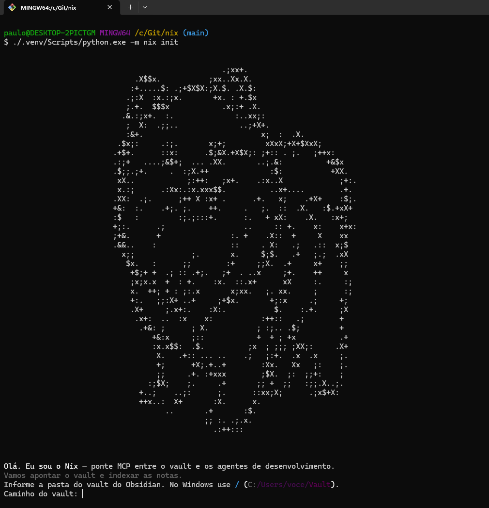

# Nix

<p align="center">
  
</p>

<p align="center">
  <a href="https://github.com/paulocesaaars/nix/releases/latest"></a>
  <a href="https://www.python.org/downloads/"></a>
</p>

Servidor [MCP](https://modelcontextprotocol.io/) que expõe vaults do Obsidian a agentes de desenvolvimento (Cursor, Claude Code, Copilot e o Devin CLI). Busca híbrida, leitura e escrita nas notas — com embeddings e banco vetorial **locais e gratuitos**. O raciocínio fica no cliente; o Nix só entrega ferramentas.

Transporte: **MCP stdio**. Sem subcomando, `nix` inicia o servidor.

## Por que usar

- O agente do editor **encontra ideias**, não só palavras: busca semântica + léxica no vault.
- **Cria e atualiza notas** no formato do Obsidian, sem sair do Cursor.
- Tudo roda **na sua máquina**. Nenhum trecho do vault vai para API de embedding.
- Você controla quando o índice muda: não há watcher em segundo plano.

## Requisitos

- Windows amd64, Linux (amd64 ou arm64) ou macOS Apple Silicon
- Um vault do Obsidian (notas `.md`)
- ~2,3 GB livres na primeira sincronização (download do modelo `BAAI/bge-m3`)

Não é preciso instalar Python. O arquivo baixado já traz o runtime.

## Instalação

O instalador baixa o binário da [última release](https://github.com/paulocesaaars/nix/releases/latest), confere o SHA-256, grava `NIX_HOME` e dispara `nix init` se ainda não houver `settings.db`.

**Windows (PowerShell):**

```powershell
irm https://raw.githubusercontent.com/paulocesaaars/nix/main/install.ps1 | iex
# ou, se já souber o vault, baixe o script e rode:
# .\install.ps1 --vault "C:/Obsidian/MeuVault"
```

**Linux e macOS:**

```bash
curl -fsSL https://raw.githubusercontent.com/paulocesaaars/nix/main/install.sh | sh
# com o vault já conhecido:
# curl -fsSL .../install.sh -o install.sh && sh install.sh --vault "$HOME/Vault"
```

No Windows use barras `/` no caminho do vault (`C:/Obsidian/MeuVault`).

A pasta da instalação é `%LOCALAPPDATA%\nix` no Windows, `~/Library/Application Support/nix` no macOS e `~/.local/share/nix` no Linux (ou o `NIX_HOME` que já existir). O binário fica em `{NIX_HOME}/bin`. Windows arm64 e macOS Intel não têm binário: o instalador diz isso e para.

<p>
  
</p>

Depois registre o servidor no editor — veja [Registro no cliente MCP](#registro-no-cliente-mcp). O instalador grava `NIX_HOME` e coloca `nix` no PATH. Abra um novo terminal e rode `nix doctor` / `nix sync`. Se o registro automático falhar, veja [INSTALL.md](INSTALL.md#registrar-nix_home-e-o-path-à-mão). Se o gerenciador Nix (NixOS) já estiver no PATH, o instalador avisa: este `nix` passa a ter prioridade.

`NIX_VERSION=1.2.3` (com ou sem o `v`) instala uma release específica.

### A partir do código (desenvolvedor)

Quem altera o Nix usa um `venv`. O `install.ps1` da raiz baixa o binário publicado; não instala este checkout.

```bash
python -m venv .venv
# Windows (Git Bash): source .venv/Scripts/activate
# Linux/macOS:        source .venv/bin/activate

pip install -r requirements-dev.txt
pip install -e .
python -m nix init                # ou: python -m nix init --vault "C:/Obsidian/MeuVault"
```

O mesmo fluxo, com registro de PATH, é `python scripts/bootstrap.py`. Para desfazer o checkout: `python scripts/uninstall.py`.

`python -m nix` vale depois de ativar o venv. O Cursor não herda o `PATH` do terminal — no MCP de desenvolvimento aponte `command` para o Python do `.venv` com `-P -m nix`, ou para o shim `bin/nix` deste checkout.

### Skills de agente (desenvolvedor)

As skills usadas no desenvolvimento (revisão de código, atualização da documentação, release e configuração do `AGENTS.md`/`CLAUDE.md`) vêm de [paulocesaaars/skills](https://github.com/paulocesaaars/skills) e ficam versionadas neste repositório, em `.claude/skills/` (Claude Code e Cursor) e `.agents/skills/` (Cursor). O `skills-lock.json` registra a origem de cada uma. Não edite as cópias daqui: altere no repositório de skills e atualize, na raiz deste projeto:

```bash
npx skills update -y
```

Para reinstalar do zero:

```bash
npx skills add paulocesaaars/skills -a claude-code -a cursor --copy -y
```

## Desinstalar

`uninstall.bat`, `.\uninstall.ps1` ou `sh uninstall.sh`. Confirme com `s`, ou passe `--yes`. Isso remove o PATH, o binário, o índice (`.nix/`) e o `settings.db` da pasta `NIX_HOME`. O vault **não** é apagado. `--keep-data` preserva a configuração e o índice. Detalhes: [INSTALL.md](INSTALL.md#desinstalação).

## Registro no cliente MCP

O cliente inicia o processo. Recarregue os servidores MCP depois de salvar.

`command` deve apontar para o binário **dentro da pasta da instalação** (`NIX_HOME`), não para o nome `nix` no PATH. O editor aberto pelo Dock ou pelo menu **não** herda o PATH do terminal (`spawn nix ENOENT`). O caminho aparece em `nix doctor`, na linha `comando nix:`.

**Cursor** — `.cursor/mcp.json` no workspace:

**Windows**

```json
{
  "mcpServers": {
    "nix": {
      "command": "${env:NIX_HOME}/bin/nix.exe"
    }
  }
}
```

No Windows a IDE lê a variável de usuário `NIX_HOME`. Também vale o caminho absoluto, por exemplo `C:/Users/voce/AppData/Local/nix/bin/nix.exe`.

**macOS / Linux**

```json
{
  "mcpServers": {
    "nix": {
      "command": "/Users/voce/Library/Application Support/nix/bin/nix"
    }
  }
}
```

Troque pelo caminho da linha `comando nix:` do `nix doctor`. No Linux a pasta padrão é `~/.local/share/nix/bin/nix`. `"command": "nix"` falha na IDE. `${env:NIX_HOME}` em geral **não** expande: o app não lê `.zshrc` / `.bashrc`.

O mesmo padrão vale para Claude Code, Copilot e o Devin CLI (`devin mcp add`). O Devin na nuvem não alcança o nix desta máquina. stdout é do protocolo MCP: logs só em `.nix/logs/nix.log` na pasta do Nix.

## Primeiros passos

Depois do `init` (o instalador já dispara isso), **abra um novo terminal** e rode:

```bash
nix doctor
nix sync
nix status
```

Se `nix` não for encontrado, o terminal ainda tem o PATH antigo: feche-o e abra outro.

## Registrar NIX_HOME e o PATH à mão

Se o instalador não gravar as variáveis, o passo a passo está só no [INSTALL.md](INSTALL.md#registrar-nix_home-e-o-path-à-mão). Grave o que faltou e abra um **terminal novo**.

O primeiro `sync` (ou qualquer operação que embede) baixa o modelo configurado. O padrão `BAAI/bge-m3` pesa ~2,3 GB. **Não precisa de GPU**, mas na CPU a primeira carga e cada nota podem levar muitos minutos — a barra só avança ao terminar o arquivo. Em máquina fraca com português, use `sentence-transformers/paraphrase-multilingual-MiniLM-L12-v2` (~220 MB) e rode `nix sync --full`. O `nix init` lista a comparação.

Notas novas sem pasta no caminho vão para `vault.default_new_note_folder` (padrão `Inbox`).

## Indexação

Esta é a regra central:

> Alterações feitas **fora** do Nix (Obsidian, editor) **não** são indexadas sozinhas. Alterações feitas pelas ferramentas MCP atualizam o índice na mesma operação.

Depois de editar no Obsidian, rode `nix sync` ou peça `sync_index` ao agente. Se a vetorização de uma escrita falhar, o arquivo permanece no vault (fonte da verdade) e um `nix sync` corrige o índice.

## CLI

| Comando | Função |
| --- | --- |
| `nix` | Inicia o servidor MCP stdio |
| `nix init [--name NOME] [--vault PATH] [--embedding-model NOME] [--force]` | Grava o primeiro vault e o modelo no `settings.db`. Sem `--name`, o nome é `Default` |
| `nix vault list\|add\|rename\|remove\|default\|path\|set` | Cadastra até 5 vaults, renomeia, remove, escolhe o padrão, troca a pasta e grava os ajustes daquele vault |
| `nix config list\|get\|set\|unset\|history\|undo` | Lê, grava e desfaz a configuração global |
| `nix sync [--full] [--dry-run] [--json] [--vault NOME]... [--all]` | Sincroniza o índice (nunca automático) |
| `nix status [--json] [--vault NOME]... [--all]` | Notas, chunks, último sync e defasagem |
| `nix doctor [--json]` | Diagnóstico de ambiente, config e índice de cada vault |
| `nix ui [--no-browser] [--port N]` | Abre a interface local (status, sync, diagnóstico, consultas, conexão de clientes, tráfego MCP, backups, vaults, configuração, histórico) |

De 1 a 5 vaults no mesmo Nix. Sem `--vault` e sem `--all`, `nix sync` e `nix status` usam o padrão. `--vault` pode repetir; `--all` percorre todos, em sequência — não combine os dois. `--name` no `init` só vale na criação do primeiro vault; para os seguintes, `nix vault add NOME CAMINHO`.

`nix vault rename` troca o nome e não move o índice nem os backups. Se a busca ficar vazia, rode `nix sync --full --vault NOME`. Remover o padrão é recusado até `nix vault default` apontar outro. O último vault não sai. Um nome no formato `AAAAMMDDTHHMMSS` é recusado. Renomear, remover, `nix vault path` e `nix vault set` esperam se aquele vault estiver sincronizando.

Nas ferramentas, omitir `vault` usa o padrão. Busca, listas, status e sync aceitam um nome, uma lista ou `"*"` (todos). Escrita aceita um nome só.

## Ferramentas MCP

Vinte ferramentas, definidas em `src/nix/core/tools/registry.py`. Notas do vault padrão aparecem como recurso `nix://note/{+rel_path}`; um vault nomeado, como `nix://vault/{name}/note/{+rel_path}`.

| Ferramenta | Uso |
| --- | --- |
| `search_notes` | Busca híbrida (semântica + léxica), com filtros de pasta, tags e datas |
| `read_note` | Lê a nota inteira. Em notas longas, prefira o outline e a leitura por linhas |
| `get_note_outline` | Título, chaves do frontmatter, total de linhas e headings |
| `read_note_lines` | Intervalo de linhas do arquivo ou um heading (até 400 linhas) |
| `list_notes` | Lista notas indexadas (pasta, tag) |
| `list_all_tags` | Tags indexadas com contagem; alimenta o filtro `tag` |
| `get_linked_notes` | Navega wikilinks (`outgoing`, `incoming` ou `both`) |
| `create_note` | Cria nota e indexa na hora (write-through) |
| `append_to_note` | Anexa conteúdo e reindexa |
| `update_note` | `replace` exige `confirm=true`; `patch` anexa; `prepend` insere após o YAML |
| `update_frontmatter` | Altera chaves de topo e preserva o restante do YAML |
| `manage_tags` | Adiciona ou remove tags do frontmatter; não mexe nas tags do corpo |
| `move_note` | Move uma nota `.md` e reescreve os links que apontam para ela |
| `move_file` | Move anexo (PDF, imagem etc.); notas `.md` ficam com `move_note` |
| `delete_note` | Remove nota e índice; exige `confirm=true` |
| `sync_index` | Sincronização manual (`full`, `dry_run`) |
| `index_status` | Contagens, último sync e defasagem, por vault |
| `vault_insights` | Órfãs, duplicatas, sugestão de links ou resumo |
| `remember` | Grava fato duradouro em `longterm_folder` do vault |
| `list_vaults` | Nome, caminho, padrão e se o índice daquele vault está desatualizado |

## Configuração

Fica em `settings.db`, na pasta do Nix (`NIX_HOME`; no checkout de desenvolvimento, a pasta do repositório). Caminhos relativos resolvem contra essa pasta. Variáveis `NIX_SECAO__CAMPO` ganham do banco nos campos globais (ex.: `NIX_INDEX__EMBEDDING_MODEL`) e o campo correspondente fica travado no `nix config` e na interface. O cadastro dos vaults não usa essa variável: nome, pasta, padrão e ajustes (`include`, `exclude`, pastas) ficam no `nix vault`. `nix vault set NOME CAMPO VALOR` grava um ajuste; listas e objetos entram como JSON. `nix vault path NOME CAMINHO` troca a pasta. `nix init` grava o primeiro vault e o modelo. `nix config set secao.chave valor` altera um campo global; listas e objetos entram como JSON. `nix config undo` restaura o valor anterior.

`nix ui` abre as mesmas operações no navegador, sem precisar de um LLM:

- **Operação:** status, sincronização com prévia e progresso (os botões ficam desligados até o job terminar, também se a página for recarregada) e diagnóstico.
- **Vault (somente leitura):** busca em um, em vários ou em todos, notas (com outline e trechos), tags e insights. O seletor "Vault ativo", no topo da barra lateral, usa `?vault=`; sem ele, vale o padrão.
- **Integração:** trechos prontos para conectar Cursor, Claude Code, VS Code e Devin CLI; tráfego MCP, com as chamadas que os clientes fazem, gravadas em `.nix/traffic.db`.
- **Manutenção:** backups das escritas (comparação e download) e a restauração de um backup, a única escrita no vault feita pela interface, com confirmação; tela Vaults; formulário de configuração e histórico.

O comando exige o `nix init`, escuta só em `127.0.0.1` e encerra com Ctrl+C ou pelo botão Encerrar. `--no-browser` só imprime a URL; `--port` fixa a porta.

| Chave | Padrão | Função |
| --- | --- | --- |
| vault (cadastro) | nome `Default` no `nix init` | Pasta de cada vault, via `nix vault`. De 1 a 5, um padrão |
| exclusões do vault | `.obsidian`, `.trash`, `Templates`, `Privado` | Pastas ignoradas daquele vault. Mude com `nix vault set NOME exclude VALOR` |
| pasta de notas novas | `Inbox` | Destino de notas sem pasta no caminho |
| pasta do `remember` | `Nix/Memória` | Destino da ferramenta `remember` |
| `index.data_dir` | `.nix/data` | Base do índice; cada vault usa `.nix/data/<nome>` |
| `logging.file` | `.nix/logs/nix.log` | Logs; consultas só entram se `log_prompts` estiver ligado |

## Publicar uma versão

Uma release no GitHub é criada automaticamente quando uma tag `vX.Y.Z` chega no remoto. O workflow [`.github/workflows/release.yml`](.github/workflows/release.yml) confere a versão, roda `ruff` e `mypy`, compila um binário por plataforma (Windows amd64, Linux amd64, Linux arm64, macOS arm64) e publica os arquivos com `checksums.txt` em [Releases](https://github.com/paulocesaaars/nix/releases).

1. Atualize `[project].version` em `pyproject.toml` (ex.: `1.2.3`). A tag **precisa** bater com esse valor — senão o job falha.
2. Faça o commit e o push na branch principal.
3. Crie e envie a tag (o `v` no prefixo é obrigatório):

```bash
git tag v1.2.3
git push origin v1.2.3
```

4. Acompanhe o workflow **Release** em Actions. Em caso de sucesso, a release traz um binário por plataforma e o `checksums.txt`.

Para republicar os artefatos de uma tag que já existe, dispare o workflow à mão: Actions → Release → Run workflow, e informe a tag (ex.: `v1.2.3`).

## Documentação

- [PRD.md](PRD.md) — produto, requisitos e regras de negócio
- [TDD.md](TDD.md) — especificações técnicas: componentes, indexação, recuperação e MCP stdio
