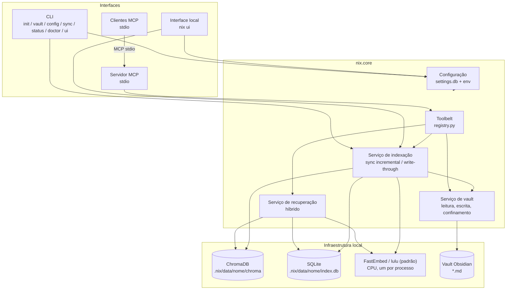
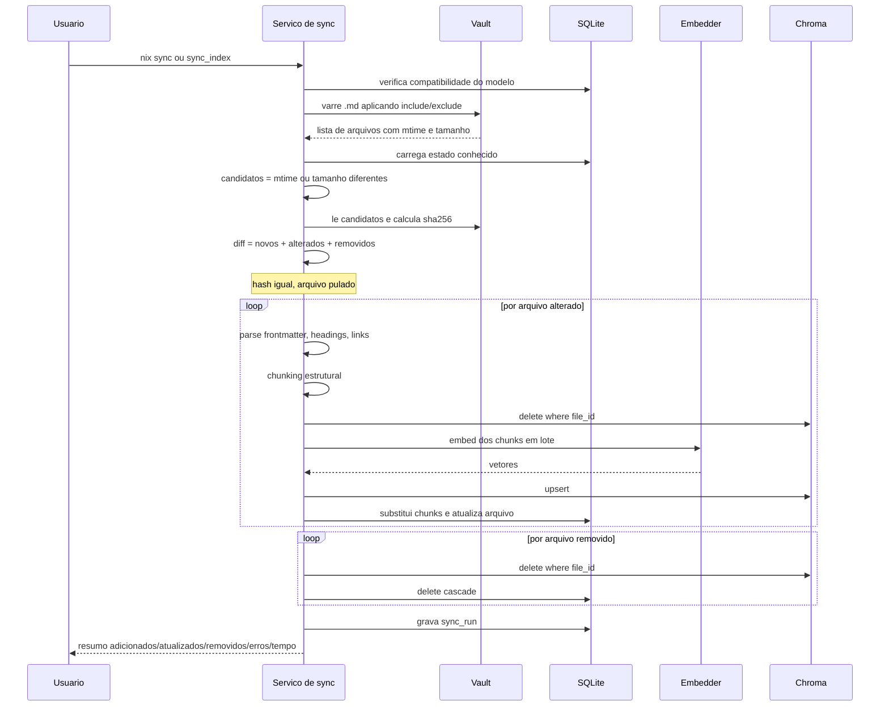
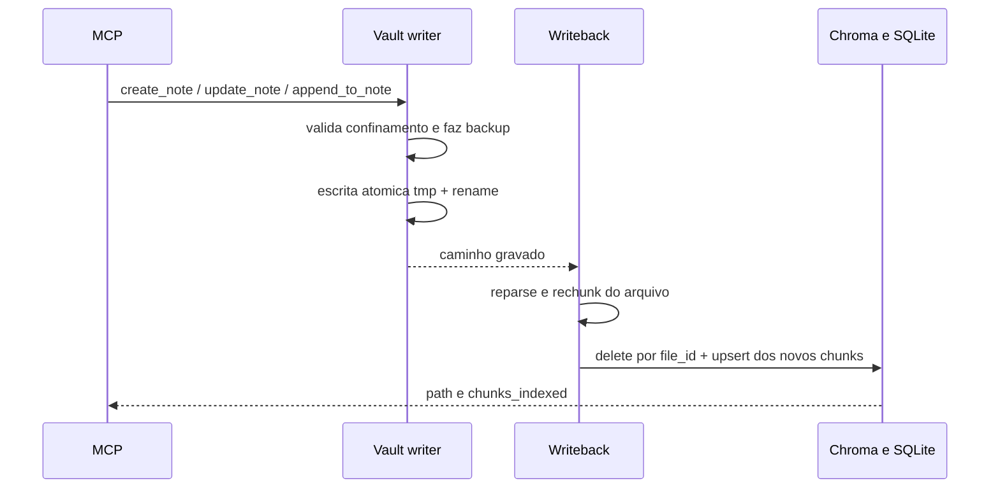
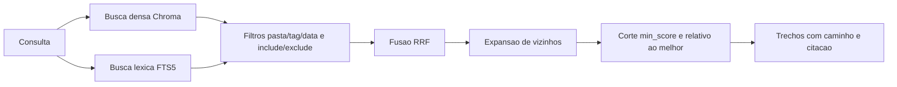

# TDD — Nix

Especificações técnicas do Nix, servidor MCP que expõe vaults do Obsidian a agentes de desenvolvimento.

Contexto de negócio e requisitos: [PRD.md](./PRD.md).

---

## 1. Princípios de design

1. **Núcleo independente de interface.** Toda a lógica vive em `nix.core`. CLI, MCP e a interface local são adaptadores finos que chamam os mesmos serviços. Nenhuma regra de negócio é duplicada.
2. **Local por padrão.** Embeddings e banco vetorial rodam na máquina do usuário, sem custo e sem enviar o vault para terceiros. O Nix não faz chamadas remotas.
3. **Indexação sob consentimento.** Não existe watcher de arquivos. O vault só é varrido quando o usuário pede (`nix sync` / ferramenta `sync_index`) ou quando as próprias ferramentas escrevem (write-through).
4. **O vault é a fonte da verdade.** O índice é um artefato derivado e descartável: apagar a pasta daquele vault em `index.data_dir` (padrão `.nix/data/<nome>`) e rodar `nix sync --full --vault NOME` reconstrói tudo.
5. **Ferramentas antes de prompts.** A capacidade exposta ao cliente é um conjunto pequeno e bem tipado de ferramentas, definido uma vez em `core/tools/registry.py`.
6. **Falhar de forma explícita.** Erros de configuração, defasagem de índice e ausência de resultados são comunicados, nunca mascarados.

## 2. Stack

| Camada | Tecnologia | Justificativa |
| --- | --- | --- |
| Linguagem | Python 3.11+ (CI e tipos em 3.14) | Ecossistema de IA e requisito do projeto |
| Embeddings | FastEmbed ONNX na CPU. Padrão `lulu` (MiniLM multilíngue, ~220 MB); `spitz` é o `BAAI/bge-m3` (~2,3 GB) | Local, gratuito, multilíngue, sem GPU, sem PyTorch |
| Banco vetorial | ChromaDB 1.5.x em modo persistente | Local, gratuito, embutido; faixa pinada pelo grafo de import (OTEL/gRPC) |
| Busca léxica | SQLite FTS5 | Já disponível na stdlib; complementa a busca vetorial em termos exatos |
| Estado do índice | SQLite | Controle de arquivos, hashes e chunks; transacional |
| CLI de bootstrap | Typer + Rich | Comandos tipados, ajuda automática, saída formatada e progresso |
| Servidor MCP | SDK oficial `mcp` (FastMCP, **somente stdio**) | O cliente inicia o processo; stdout é do protocolo |
| Interface local | Starlette + Uvicorn (já no SDK `mcp`) + Jinja2, HTMX e CSS próprio (`web/static/nix.css`) vendidos no pacote | Operação e consulta no navegador, sem Node, sem build e sem CDN |
| Configuração | SQLite (`settings.db`) + Pydantic | Histórico e desfazer no mesmo arquivo, validação forte, override por variável de ambiente |
| Parsing de Markdown | `python-frontmatter` + splitter consciente de cabeçalhos | Preserva metadados e estrutura das notas |
| Qualidade | ruff, mypy | Padrão do ecossistema |

**Por que embeddings locais e não `text-embedding-3`:** o requisito é custo zero na indexação. Um vault grande gera dezenas de milhares de chunks e cada reindexação completa teria custo. Os dois modelos rodam na CPU e são multilíngues. A `lulu` é o padrão porque o sync cabe num computador com pouca folga. O `spitz` (`bge-m3`) fica para quem tem CPU, memória e disco de sobra e quer mais qualidade na busca.

**Por que Chroma e não FAISS/LanceDB:** Chroma persiste sozinho, guarda metadados junto do vetor e permite deletar por `file_id` na sincronização incremental. Filtros de pasta/tag/data são aplicados na camada de recuperação (prefixo de pasta, tags, `mtime`), não como `where` de igualdade no Chroma — subpastas continuam visíveis. FAISS exigiria gerenciar o mapeamento id↔metadado manualmente.

## 3. Visão de componentes



Um processo MCP (ou `nix ui`) atende de 1 a 5 vaults. `RuntimeHost` guarda um `Runtime` por nome, criado na primeira resolução e fechado quando o vault sai do `settings.db`. `resolve(nome | None)` abre um vault (nome omitido usa o padrão). `resolve_many(nome | lista | "*")` abre vários; nome desconhecido lista os cadastrados e diz qual é o padrão. O modelo de embedding é um só (`index.embedding_model`): o `Embedder` é do processo, com `threading.RLock` no carregamento e no `embed`, para dois vaults não rodarem inferência ao mesmo tempo.

### 3.1 Pastas por vault

`index.data_dir` e `safety.backup_dir` continuam globais. O que é de um vault fica numa subpasta com o nome cadastrado:

| Artefato | Caminho |
| --- | --- |
| Índice (SQLite + Chroma) | `{index.data_dir}/<nome>/` (padrão `.nix/data/<nome>/`) |
| Backups | `{safety.backup_dir}/<nome>/` (padrão `.nix/backups/<nome>/`) |
| Trava de sync e write-through | `{app_root}/.nix/sync-<nome>.lock` |

A trava é por vault: um pode sincronizar enquanto outro é lido. Renomear o vault não move índice nem backups; a CLI avisa para rodar `nix sync --full --vault NOME` se a busca ficar vazia. Remover o vault do cadastro também deixa essas pastas no disco.

O vault migrado do esquema 1 é a exceção: o índice (`index.db` e o chroma) continua na raiz de `{index.data_dir}` e os backups na raiz de `{safety.backup_dir}`, para a busca e os backups não ficarem vazios. Vaults cadastrados depois usam a subpasta do nome.

## 4. Estrutura do projeto

```
nix/
├── install.bat / install.sh / install.ps1  # baixa o binário, confere SHA-256, registra PATH e inicia `nix init`
├── uninstall.bat / uninstall.sh / uninstall.ps1  # remove PATH/NIX_HOME, o binário, .nix, settings.db e o cache onefile/hook
├── bin/nix / bin/nix.cmd   # shims só do checkout de desenvolvimento (acham o .venv)
├── bin/env.sh / bin/env.cmd / bin/env.ps1  # ativação manual do PATH no checkout
├── __main__.py             # `python -m nix` a partir do projeto pai (pasta nix/)
├── scripts/bootstrap.py    # venv + pip + init (desenvolvimento)
├── scripts/build_frozen.py # Nuitka onefile, Python 3.12, na plataforma local
├── scripts/smoke_frozen.py # gate de --version, doctor --json e nix-hook
├── scripts/check_bdd.py    # cobertura dos cenários de bdd/ pelos testes
├── scripts/register_path.py # NIX_HOME e PATH do checkout de desenvolvimento
├── scripts/uninstall.py    # desfaz PATH, artefatos do checkout e o cache onefile/hook
├── nix.jpeg                # foto da Nix (mascote no README)
├── settings.db            # config local (não versionado; criado por `nix init`)
├── .nix/                   # estado local: data (SQLite+Chroma), backups, logs, sessions.db
├── pyproject.toml          # metadados do pacote e entry point do comando `nix`
├── requirements.txt        # dependências de runtime
├── requirements-dev.txt    # dependências de desenvolvimento
├── README.md
├── PRD.md
├── TDD.md
├── BDD.md                  # índice dos casos de uso do BDD
├── bdd/                    # critérios de aceite em Gherkin, um arquivo por caso de uso (um teste por cenário)
├── tests/                  # pytest; conftest.py isola NIX_HOME e troca o embedder
├── DESIGN.md               # estilo visual da CLI e da interface local
├── AGENTS.md / CLAUDE.md   # instruções de agente (CLAUDE.md importa o AGENTS.md)
├── HARNESS.md              # regras específicas deste repositório
├── skills-lock.json        # origem das skills de desenvolvimento
├── .claude/skills/ / .agents/skills/  # skills de desenvolvimento
├── .cursor/
│   └── mcp.json            # command = binário em NIX_HOME (caminho absoluto no Unix)
└── src/
    ├── nix_launch.py           # relança o venv, desfaz sombreamento da pasta nix/; `nix hook` segue direto para sessions/hook_entry
    ├── nix_frozen.py           # entrada do binário completo; não relança o .venv
    ├── nix_hook_frozen.py      # entrada do binário leve `nix-hook`
    └── nix/
        ├── __init__.py             # versão: pyproject.toml no checkout; metadata no binário
        ├── __main__.py             # python -m nix (pacote instalado)
        ├── skills/                 # SKILL.md de produto; `nix skills install` copia para o projeto
        │   └── sessoes-nix/SKILL.md
        ├── config/
        │   ├── schema.py           # modelos Pydantic da configuração e textos de ajuda
        │   ├── embedding_models.py # catálogo técnico dos embeddings (validação + FastEmbed)
        │   ├── embedding_present.py # textos de apresentação dos modelos (CLI e interface)
        │   ├── store.py            # settings.db: valores, histórico, versão do esquema
        │   ├── editor.py           # gravação validada (CLI e interface)
        │   ├── loader.py           # precedência env > banco > padrão; vaults vêm da tabela
        │   ├── session_defaults.py # padrões de `sessions.*` e validação da pasta; sem dependências, o hook e o schema importam daqui
        │   ├── executables.py      # no binário publicado, aponta o hook para o irmão `nix-hook`
        │   └── paths.py            # app_root; no binário, NIX_HOME ou a pasta de dados da plataforma
        ├── core/
        │   ├── vault/
        │   │   ├── reader.py       # varredura, filtros, leitura segura
        │   │   ├── writer.py       # escrita atômica, backup, YAML, confinamento
        │   │   ├── markdown.py     # frontmatter, cabeçalhos, wikilinks, tags, links
        │   │   ├── frontmatter_edit.py  # edição linha a linha do YAML
        │   │   ├── paths.py        # normalização e validação de caminhos
        │   │   └── longterm.py     # remember → notas no vault
        │   ├── index/
        │   │   ├── store.py        # SQLite: arquivos, chunks, metadados
        │   │   ├── chunker.py      # divisão consciente da estrutura
        │   │   ├── embedder.py     # FastEmbed em lote; RLock na carga e no embed
        │   │   ├── native_compat.py # mmh3 nativo ou stub (só import FastEmbed)
        │   │   ├── tokenize.py     # tiktoken, com aproximação se a DLL falhar
        │   │   ├── vectorstore.py  # adaptador Chroma
        │   │   ├── sync.py         # diff e sincronização incremental
        │   │   ├── lock.py         # trava entre processos (.nix/sync-<nome>.lock)
        │   │   ├── writeback.py    # reindexação write-through
        │   │   ├── attachments.py  # texto de PDFs referenciados
        │   │   ├── graph.py        # grafo de wikilinks (cache)
        │   │   └── staleness.py    # aviso de defasagem (só Markdown)
        │   ├── retrieval/
        │   │   ├── vector.py       # busca densa
        │   │   ├── lexical.py      # busca FTS5
        │   │   ├── fusion.py       # Reciprocal Rank Fusion
        │   │   └── service.py      # fachada de recuperação
        │   ├── insights/           # órfãs, duplicatas, links, resumo
        │   ├── sessions/           # sessões dos agentes (só stdlib nos módulos do hook)
        │   │   ├── hook_entry.py   # `nix hook`: stdin → evento → sessions.db; handoff no stdout do início
        │   │   ├── agents.py       # lista única dos agentes, rótulos e formato do contexto de início de sessão
        │   │   ├── events.py       # normaliza o JSON de cada agente; id determinístico; raiz Git do projeto
        │   │   ├── sanitize.py     # segredos e corte UTF-8
        │   │   ├── limits.py       # limites e padrões extras lidos do settings.db sem Pydantic
        │   │   ├── store.py        # sessions.db: sessions, events, handoffs, hook_projects
        │   │   ├── handoff.py      # texto do handoff, criação, escolha da sessão de origem
        │   │   ├── service.py      # gravar a nota da sessão e consolidar a fila; CLI, MCP e interface delegam a ele
        │   │   ├── drain.py        # fila do session-end, consolidador destacado e trava
        │   │   ├── render.py       # nota Markdown da sessão no vault
        │   │   └── paths.py        # caminho da nota e URI somente leitura do SQLite
        │   ├── runtime.py          # RuntimeHost: resolve / resolve_many, Embedder compartilhado
        │   ├── admin/              # init, doctor, VaultService, agent_hooks, agent_skills, empty_dirs
        │   └── tools/
        │       ├── args.py         # VaultArgs (um nome) e MultiVaultArgs (nome, lista ou "*")
        │       ├── registry.py     # definição canônica das ferramentas
        │       ├── search.py
        │       ├── notes.py
        │       ├── maintenance.py
        │       └── sessions.py     # list_sessions, read_session, session_handoff
        ├── cli/
        │   ├── app.py              # entrypoint Typer (sem args → servidor stdio)
        │   ├── ascii-art.txt
        │   ├── commands/
        │   │   ├── setup.py        # init, doctor
        │   │   ├── vault_cmds.py   # nix vault list/add/rename/remove/default/path/set
        │   │   ├── config_cmds.py  # config list/get/set/unset/history/undo
        │   │   ├── ui_cmd.py       # nix ui
        │   │   ├── session_cmds.py # nix session list/show/render/handoff
        │   │   ├── hooks_cmds.py   # nix hooks install/remove/status
        │   │   ├── skills_cmds.py  # nix skills install/remove/status
        │   │   └── index_cmds.py   # sync, status (status via call_tool)
        │   ├── agents.py           # agentes pedidos ou confirmados, e a raiz do projeto
        │   ├── embedding_copy.py   # tabela do nix init; textos em config/embedding_present.py
        │   └── render.py           # tema e o resultado de cada comando; erros em stderr
        ├── mcp/
        │   ├── server.py           # FastMCP/MCPServer stdio; recarrega a config entre chamadas
        │   ├── traffic.py          # log de interações MCP (arquivo e .nix/traffic.db)
        │   └── resources.py        # nix://note/… no padrão; nix://vault/{name}/note/…
        ├── web/                    # nix ui: Starlette, templates Jinja2, HTMX e nix.css vendidos
        │   └── routes/             # ops, vault, integration, maintenance, sessions
        └── observability/
            ├── logging.py
            └── stdio.py            # isola stdout de bibliotecas
```

Quem usa o Nix instala um binário único (Nuitka, arquivo só, sem Python na máquina). O instalador (`install.ps1` / `install.sh`, e `install.bat` que delega ao PowerShell) baixa o artefato da release, confere o SHA-256, grava `NIX_HOME` e dispara `nix init`. O desinstalador em shell puro desfaz o PATH e apaga o binário, `.nix/` e `settings.db`.

O checkout de desenvolvimento continua com `venv` e `pip`: `python scripts/bootstrap.py` cria `.venv`, instala `requirements.txt` e o pacote em modo editável (`pip install -e .`). `scripts/uninstall.py` desfaz esse checkout. O `pyproject.toml` se limita aos metadados do pacote e à declaração do *entry point* `nix`. No checkout, com o pacote em `src/nix`, `nix.__version__` lê `[project].version` desse arquivo, para uma instalação editável não mostrar metadata velho. Fora do checkout, vale o metadata do pacote instalado. O binário é compilado por `scripts/build_frozen.py` com Python 3.12.

## 5. Modelo de dados

### 5.1 SQLite (`{index.data_dir}/<nome>/index.db`, padrão `.nix/data/<nome>/index.db`)

Guarda o estado do índice: o que já foi processado, com qual conteúdo e com qual modelo. É a base do diff incremental.

```sql
CREATE TABLE files (
    id            TEXT PRIMARY KEY,       -- uuid estável por caminho relativo
    rel_path      TEXT NOT NULL UNIQUE,   -- 'Projetos/Nix.md'
    title         TEXT,
    content_hash  TEXT NOT NULL,          -- sha256 do conteúdo
    mtime         REAL NOT NULL,
    size_bytes    INTEGER NOT NULL,
    frontmatter   TEXT,                   -- JSON
    tags          TEXT,                   -- JSON array
    links         TEXT,                   -- JSON array de wikilinks
    chunk_count   INTEGER NOT NULL DEFAULT 0,
    indexed_at    TEXT NOT NULL,
    status        TEXT NOT NULL           -- indexed | error | ignored
);

CREATE TABLE chunks (
    id            TEXT PRIMARY KEY,       -- '{file_id}:{ordinal}'
    file_id       TEXT NOT NULL REFERENCES files(id) ON DELETE CASCADE,
    ordinal       INTEGER NOT NULL,
    heading_path  TEXT,                   -- 'Arquitetura > Indexação'
    content       TEXT NOT NULL,
    title         TEXT NOT NULL DEFAULT '',
    token_count   INTEGER NOT NULL,
    start_line    INTEGER,
    end_line      INTEGER,
    embed_hash    TEXT                    -- hash do texto vetorizado; nulo até o sync do arquivo
);

-- Busca léxica sobre os mesmos chunks
CREATE VIRTUAL TABLE chunks_fts USING fts5(
    content, heading_path, title,
    content='chunks', content_rowid='rowid', tokenize='unicode61'
);

CREATE TABLE index_meta (
    key   TEXT PRIMARY KEY,               -- embedding_model, dim, vault_path,
    value TEXT NOT NULL                   -- schema_version, last_sync_at
);

CREATE TABLE sync_runs (
    id           INTEGER PRIMARY KEY AUTOINCREMENT,
    started_at   TEXT NOT NULL,
    finished_at  TEXT,
    trigger      TEXT NOT NULL,           -- manual | writeback
    added        INTEGER DEFAULT 0,
    updated      INTEGER DEFAULT 0,
    removed      INTEGER DEFAULT 0,
    failed       INTEGER DEFAULT 0,
    error_log    TEXT
);
```

`embed_hash` guarda o hash do texto vetorizado de cada chunk (RF-150). Um índice criado antes dessa coluna a recebe por `ALTER TABLE`, sem trocar o `schema_version`.

`index_meta.embedding_model` é comparado a cada execução: se o usuário trocar o modelo na configuração, o índice é considerado incompatível e o Nix exige `nix sync --full` em vez de misturar vetores de espaços diferentes.

### 5.2 Coleção Chroma

Uma coleção `nix_notes` por vault, em `{index.data_dir}/<nome>/chroma`, um vetor por chunk, `id` idêntico ao `chunks.id`. Metadados armazenados junto:

| Campo | Uso |
| --- | --- |
| `file_id` | Deleção em massa na reindexação de um arquivo |
| `rel_path`, `title` | Citação e abertura da nota |
| `heading_path` | Contexto do trecho na resposta |
| `tags` | Filtro por tag (após a busca; armazenado como string concatenada no Chroma) |
| `folder` | Prefixo da pasta (inclui subpastas), filtrado após a busca — sem `where` de igualdade no Chroma |
| `mtime` | Filtro por recência e desempate |
| `ordinal` | Reconstrução da ordem e expansão de vizinhos |

### 5.3 Sessões (`{app_root}/.nix/sessions.db`)

SQLite em WAL, fora do vault e fora do índice. Cada operação abre e fecha a conexão, com transação curta, para vários hooks gravarem ao mesmo tempo.

```sql
CREATE TABLE sessions (
    key TEXT PRIMARY KEY,            -- agente:id da sessão
    agent TEXT NOT NULL, session_id TEXT NOT NULL,
    project TEXT NOT NULL, project_name TEXT NOT NULL, cwd TEXT NOT NULL DEFAULT '',
    started TEXT NOT NULL, updated TEXT NOT NULL,
    status TEXT NOT NULL DEFAULT 'aberta',   -- aberta | encerrada
    note_path TEXT, note_vault TEXT, rendered_at TEXT
);
CREATE TABLE events (
    seq INTEGER PRIMARY KEY AUTOINCREMENT,
    id TEXT NOT NULL UNIQUE,         -- sha256 de agente, sessão, tipo, alvo, texto e segundo: o mesmo evento não duplica
    session_key TEXT NOT NULL REFERENCES sessions(key) ON DELETE CASCADE,
    ts TEXT NOT NULL, type TEXT NOT NULL,    -- session-start | user-prompt | pre-tool | post-tool | compact | stop | session-end | other
    tool TEXT NOT NULL DEFAULT '', target TEXT NOT NULL DEFAULT '', text TEXT NOT NULL DEFAULT '',
    is_error INTEGER NOT NULL DEFAULT 0
);
CREATE TABLE handoffs (
    id INTEGER PRIMARY KEY AUTOINCREMENT,
    project TEXT NOT NULL, session_key TEXT NOT NULL,
    state TEXT NOT NULL,             -- pendente | consumido | cancelado
    text TEXT NOT NULL, note_path TEXT, created_at TEXT NOT NULL,
    consumed_at TEXT, consumed_by TEXT
);
CREATE TABLE hook_projects (         -- RN-07: só projetos com hooks instalados gravam
    project TEXT NOT NULL, agent TEXT NOT NULL, hook_file TEXT NOT NULL DEFAULT '', installed_at TEXT NOT NULL,
    PRIMARY KEY (project, agent)
);
```

O handoff pendente é entregue por um único `UPDATE ... RETURNING`: dois agentes não levam o mesmo. A coluna `chunks.embed_hash` do índice (5.1) guarda o hash do texto vetorizado de cada chunk (RF-150); índices criados antes dela ganham a coluna por `ALTER TABLE`, sem trocar o `schema_version`.

## 6. Pipeline de indexação

### 6.1 Detecção de mudanças



O filtro em duas etapas — `mtime`/tamanho primeiro, hash depois — evita ler todo o vault a cada sincronização e evita reindexar arquivos que só tiveram o timestamp alterado (comum em sincronização por Dropbox/Git).

Cada arquivo é uma transação independente: uma interrupção deixa o índice consistente, e a execução seguinte reprocessa apenas o que faltou (RNF-07).

### 6.2 Chunking

Notas de Obsidian têm estrutura semântica em cabeçalhos, e cortá-las por número fixo de caracteres destrói essa estrutura. A estratégia:

1. Extrair frontmatter YAML (vira metadado JSON-serializável — datas ISO — não texto indexado).
2. Dividir por cabeçalhos Markdown (`#` até `####`), mantendo o caminho hierárquico (`Projeto Nix > Arquitetura > Indexação`).
3. Seções maiores que o limite são subdivididas recursivamente por parágrafo/sentença, com sobreposição configurável.
4. Seções muito pequenas (ex.: um cabeçalho com duas linhas) são agrupadas com a seção seguinte, evitando chunks sem sinal.
5. Blocos de código nunca são partidos ao meio.
6. Cada chunk é prefixado, apenas para o embedding, com `título da nota > caminho de cabeçalhos`, o que melhora a recuperação de trechos curtos.

Valores padrão: 800 tokens por chunk, 120 de sobreposição, mínimo de 80 tokens — todos configuráveis.

### 6.3 Vetorização write-through

Quando a escrita parte das ferramentas MCP, a atualização do índice faz parte da operação (RN-02):



O reprocessamento é de um único arquivo. Se a indexação falhar após a escrita, o arquivo no vault permanece (fonte da verdade), o registro vai para `status = 'error'` e a resposta informa que a nota foi salva mas não indexada — o usuário deve rodar `nix sync` ou `sync_index`. Frontmatter YAML é gravado com valores escapados; datas (`created: auto` → ISO) serializam como string, para o JSON do SQLite não quebrar em objetos `date`.

### 6.4 Aviso de defasagem

`index_status` compara a **contagem de notas Markdown** visíveis no vault com a de arquivos `.md` indexados, e o `mtime` máximo com `index_meta.last_sync_at`. PDFs anexos no índice não entram nessa conta (evita aviso falso de defasagem). Se houver divergência, devolve `stale=true`. A mensagem `stale_reason` só é preenchida quando `index.warn_when_stale=true`. Não há indexação implícita (RN-01).

### 6.5 Reaproveitamento de vetores (RF-150)

O id do chunk é `arquivo:ordinal` e se desloca com qualquer inserção no meio da nota, então o reaproveitamento casa **só pelo hash** do `embed_text` (texto com o prefixo `título > cabeçalhos`). Em `Indexer._commit_index`: lê os hashes e os vetores antigos do arquivo (`VectorStore.embeddings_for_file`, `get(where={"file_id": ...}, include=["embeddings"])`), calcula o embedding só dos chunks sem hash correspondente, apaga os chunks do arquivo e faz o `upsert` com os vetores reaproveitados e os novos. O `SyncReport` informa `chunks_reused` e `chunks_embedded`. `nix sync --full` zera os hashes junto com o índice.

## 7. Recuperação



- **Densa** resolve similaridade conceitual ("como configurar o retry" ↔ "política de nova tentativa").
- **Léxica** resolve termos exatos que embeddings costumam diluir: nomes próprios, siglas, códigos de erro, nomes de arquivo. `retrieval.expand_query=true` junta tokens com OR (mais recall); `false` usa AND (mais precisão).
- **Filtro de pasta** vale para a pasta e subpastas (`Inbox` inclui `Inbox/sub/nota.md`), aplicado em cada ramo **antes** do RRF.
- **RRF** funde os dois rankings: `score(d) = Σ 1 / (k + rank_i(d))`, com `k = 60`.
- **Expansão de vizinhos** recupera os chunks `ordinal ± 1` dos melhores resultados.
- **Corte de score** descarta trechos abaixo de `max(min_score, melhor × 0.65)`.

`search_notes` sempre passa por `search_many`, com um vault ou com vários. A consulta é vetorizada uma vez. Cada vault roda a híbrida com `candidate_pool` e os filtros, sem corte final. Os trechos são juntados, ordenados pelo score, e então `min_score` e `top_k` valem para o conjunto. Falha num vault vai para `vault_errors`, com a ação corretiva, e os outros seguem. Cada trecho traz o nome do vault.

Cada trecho devolvido por `search_notes` inclui `vault`, `rel_path`, `title`, `heading_path`, `content` e `citation` no formato `[[Título]]` / `[[Título#Seção]]` (RN-04). A síntese em linguagem natural é responsabilidade do cliente MCP.

Notas de sessão e busca (RF-107): com `sessions.enabled`, `sessions.search_default = excluir` e sem `folder` explícito, `RetrievalService` descarta a pasta de sessões no vault que as recebe, **antes** do corte do top-k: o pool denso e o léxico buscam mais candidatos (4×) e o filtro roda antes de `finish`. Com `folder` na pasta de sessões, ou com `incluir`, elas entram.

## 8. Ferramentas

Definidas uma única vez em `core/tools/registry.py` (`SPECS`, 20 ferramentas, mais 3 de sessão que só são expostas com `sessions.enabled`: 23 no total) e registradas no servidor MCP. A CLI de bootstrap chama `call_tool` para `index_status`; `nix sync` usa o mesmo `Indexer.sync` da ferramenta (com barra de progresso), um vault por vez.

`VaultArgs` é um nome, ou o padrão se o campo vier vazio. `MultiVaultArgs` aceita um nome, uma lista ou `"*"`. A comparação ignora maiúsculas. Escrita, leitura de uma nota, links e insights recusam lista e `"*"`. Busca, `list_notes`, `list_all_tags`, `index_status` e `sync_index` aceitam vários. `list_vaults` não recebe vault: devolve todos. A resposta traz `vault` (um nome ou a lista dos consultados).

| Ferramenta | Assinatura | Efeito no índice |
| --- | --- | --- |
| `search_notes` | `(query, top_k=5, folder?, tags?, date_from?, date_to?, vault?) -> {results, vault_errors}` | — ; junção em `search_many` |
| `read_note` | `(rel_path, vault?) -> NoteContent` | — |
| `get_note_outline` | `(rel_path, vault?) -> NoteOutline` (título, chaves, linhas, headings) | — |
| `read_note_lines` | `(rel_path, start_line?, end_line?, heading?, vault?) -> NoteLines` | — |
| `list_notes` | `(folder?, tag?, limit=50, vault?) -> {notes}` | — ; o limite vale **por vault** e as listas são juntadas |
| `list_all_tags` | `(folder?, limit=200, vault?) -> {tags}` | — ; soma as contagens de cada vault e só então aplica o limite; o detalhe por vault permanece |
| `get_linked_notes` | `(rel_path, direction=both, vault?) -> list[NoteRef]` | — |
| `create_note` | `(rel_path, content, frontmatter?, vault?) -> WriteResult` | write-through; pasta padrão `default_new_note_folder` (`Inbox`) se o caminho não tiver `/` |
| `append_to_note` | `(rel_path, content, section?, vault?) -> WriteResult` | write-through |
| `update_note` | `(rel_path, content, mode=replace\|patch\|prepend, confirm, vault?) -> WriteResult` | write-through; `prepend` não exige `confirm` |
| `update_frontmatter` | `(rel_path, set?, remove?, vault?) -> WriteResult` | write-through; só a chave alterada é reemitida |
| `manage_tags` | `(rel_path, add?, remove?, vault?) -> WriteResult` | write-through; tags inline do corpo ficam |
| `move_note` | `(src, dest, update_links=true, overwrite, confirm, vault?) -> WriteResult` | `after_move`: remove o id antigo, indexa o caminho novo e as notas reescritas |
| `move_file` | `(src, dest, update_links=true, overwrite, confirm, vault?) -> WriteResult` | igual a `move_note` para o id; PDF só entra no índice com `index.index_attachments` |
| `delete_note` | `(rel_path, confirm, vault?) -> WriteResult` | remove do índice |
| `sync_index` | `(full=False, dry_run=False, vault?) -> {reports}` | um vault por vez; um relatório por vault |
| `index_status` | `(vault?) -> {vaults}` | — ; um status por vault |
| `vault_insights` | `(kind, limit=20, vault?) -> insights` | — |
| `remember` | `(content, title?, vault?) -> WriteResult` | write-through em `longterm_folder` do vault |
| `list_vaults` | `() -> {vaults}` | — ; nome, caminho, padrão e se o índice está desatualizado |
| `list_sessions` | `(project?, agent?, status?, limit=20) -> {project, sessions}` | — ; lê `sessions.db`, não abre vault; só com `sessions.enabled` |
| `read_session` | `(session, project?, max_chars=8000) -> {session, events, truncated}` | — ; eventos do fim para o começo, ferramentas marcadas como já executadas |
| `session_handoff` | `(accept=true, agent?, project?) -> {handoff, state, note_path}` | com `accept=true`, grava a nota da sessão no vault (write-through) e entrega o handoff uma única vez; com `accept=false` só mostra, sem gravar nem consumir; `agent` tira a sessão em curso do chamador da escolha |

Ferramentas destrutivas (`update_note` em modo `replace`, `delete_note`) exigem `confirm=true` e levam `destructiveHint` para o cliente pedir aprovação ao usuário (RF-34). `move_note` e `move_file` não levam `destructiveHint`; sobrescrever o destino ainda exige `overwrite=true` e `confirm=true`. `read_note_lines` devolve no máximo 400 linhas (`truncated`, `next_start_line`). As linhas de `search_notes`, do outline e de `read_note_lines` são do arquivo bruto, com o frontmatter incluído.

`vault_insights` (órfãs, duplicatas, sugestão de wikilinks, resumo) usa o índice SQLite. A sugestão de links não relê o vault.

Todas as ferramentas recebem `rel_path` relativo ao vault. `core/vault/paths.py` resolve, normaliza, rejeita `..`, caminhos absolutos e links simbólicos que escapem do vault (RN-03).

## 9. Interfaces

### 9.1 Instalador e CLI de bootstrap

O instalador na raiz do repositório não entra no núcleo: só baixa o binário e registra o PATH. Não exige Python.

```
install.ps1 / install.sh          # release estável (ou NIX_VERSION) → SHA-256 → {NIX_HOME}/bin/nix e nix-hook
install.bat                       # delega a install.ps1
uninstall.ps1 / uninstall.sh      # PATH, binário, settings.db, .nix e cache onefile/hook (não o vault)
uninstall.bat                     # delega a uninstall.ps1
scripts/bootstrap.py              # só desenvolvimento: .venv → pip → register_path → nix init
scripts/build_frozen.py           # Nuitka --mode=onefile com Python 3.12; também gera o nix-hook
scripts/smoke_frozen.py           # --version só com a versão; doctor --json com cada Import em ok; nix-hook em 300 ms
```

O binário publicado cobre Windows amd64, Linux amd64 (glibc do Ubuntu 22.04), Linux arm64 e macOS arm64. Windows arm64 e macOS Intel não têm artefato: o instalador recusa com a arquitetura esperada. O modelo ONNX continua fora do arquivo; o primeiro `nix sync` baixa do Hugging Face.

O GitHub também anexa o zip e o tar do código da tag, gerados por `git archive`. O `.gitattributes` usa `export-ignore` para tirar skills de desenvolvimento, documentação, testes, exemplos, configuração de editor e de CI e os scripts que só compilam ou conferem. Permanecem o pacote, o manifesto, as dependências de execução, os wrappers, os instaladores e a skill de produto que o `nix skills install` copia. A compilação da release usa o checkout inteiro, não esse zip.

`NIX_HOME` já definido (variável de usuário no Windows, ou o bloco dos rc no Unix) é a pasta da instalação, e o binário novo substitui `{NIX_HOME}/bin`. Sem `NIX_HOME`, a pasta é `%LOCALAPPDATA%\nix`, `~/Library/Application Support/nix` ou `${XDG_DATA_HOME:-~/.local/share}/nix`. Argumentos extras (`--vault PATH`, `--force`) vão para `nix init` só quando `settings.db` ainda não existe. O instalador roda `nix --version` uma vez para aquecer o cache do modo onefile (`{CACHE_DIR}/nix/onefile-{VERSION}`) e `nix-hook hook` para aquecer o cache `hook-{VERSION}`. O comando `nix` vale num **novo** terminal. Se já existir outro `nix` no PATH (gerenciador NixOS), o instalador avisa.

O desinstalador pede confirmação (dispensada com `--yes`). Remove `NIX_HOME` e a entrada do PATH só se apontarem para esta instalação. Apaga também o cache de extração (`onefile-*` e `hook-*` em `{CACHE_DIR}/nix` e na pasta da instalação) e, se a pasta da instalação ficar vazia, a pasta. No Linux e no macOS esse cache não é a pasta da instalação; só entram diretórios com esses prefixos, para não apagar outros arquivos em `~/.cache/nix`. `--keep-data` preserva `settings.db` e `.nix/` e ainda apaga o cache de extração. O vault não é alterado. O modelo no cache do Hugging Face fica: pode ser compartilhado com outros programas.

No binário, `app_root()` ignora o checkout (o `__file__` da extração não é o repositório) e não usa o CWD: vale `$NIX_HOME` ou a pasta de dados da plataforma. `settings.db` e `.nix/` ficam nessa pasta. Copiar só o executável para outro diretório continua usando a mesma pasta de dados.

```
nix                           # inicia o servidor MCP stdio
nix init [--name NOME] [--vault PATH] [--embedding-model NOME] [--force]
                              # pergunta (ou recebe) o primeiro vault; nome padrão Default
                              # sem --force, configuração existente só atualiza o caminho do padrão
                              # --name com vaults já cadastrados pede `nix vault add`
nix vault list|add|rename|remove|default|path|set
                              # cadastro; rename não move índice nem backups
                              # path troca a pasta; set grava include/exclude e as pastas daquele vault
nix config list|get|set|unset|history|undo
nix sync [--full] [--dry-run] [--json] [--vault NOME]... [--all]
nix status [--json] [--vault NOME]... [--all]
                              # status via call_tool("index_status")
nix doctor [--json]           # relatório de todos os vaults; --json serializa o DoctorReport
nix ui [--no-browser] [--port N]
                              # interface local; exige nix init
```

`--vault` em `sync` e `status` pode repetir. `--all` percorre todos, em sequência. Os dois juntos são recusados. Sem nenhum dos dois, vale o vault padrão. `--json` em `sync` e `status` emite o relatório em formato estruturado, com um item por vault. `nix doctor --json` serializa o relatório de diagnóstico (ambiente, configuração e checagens, entre elas uma por vault). Erros de domínio (`NixError`) saem no stderr, sem traceback. Fora de `init` e `doctor`, os comandos falham com ação corretiva se o `nix init` ainda não rodou. `nix vault remove` recusa o padrão até `nix vault default` apontar outro, e recusa o último vault. `nix vault rename` preserva a grafia nova e avisa para `nix sync --full --vault NOME` se a busca ficar vazia. `nix vault path` troca a pasta. `nix vault set` grava `include`, `exclude`, `follow_symlinks`, `default_new_note_folder`, `default_frontmatter` ou `longterm_folder`; listas e objetos entram como JSON. Nome no formato `AAAAMMDDTHHMMSS` é recusado. Renomear, remover, `path` e `set` são recusados enquanto a sincronização daquele vault não termina.

Se `nix` roda sem subcomando num terminal interativo, um aviso vai para stderr e o servidor stdio inicia mesmo assim — o cliente MCP (stdin não-TTY) não vê essa mensagem.

### 9.2 Servidor MCP

Transporte **somente stdio**. O cliente inicia o processo (o binário em `{NIX_HOME}/bin`; no checkout de desenvolvimento, `python -P -m nix` no venv). Expõe as ferramentas da seção 8 e, adicionalmente, notas como recursos MCP. `nix://note/{+rel_path}` lê no vault padrão (barras no caminho; `|` também é aceito). `nix://vault/{name}/note/{+rel_path}` lê no vault nomeado. Nome desconhecido devolve o erro que lista os vaults e o padrão. O cliente anexa a nota ao contexto sem consumir uma chamada de ferramenta.

O servidor tenta `FastMCP` e, se o SDK recente expuser só `MCPServer`, usa essa classe — ambas precisam de `.tool()`, `.run()` e `transport="stdio"`. Falha de instância ou de transporte vira `ConfigError` com ação corretiva (`pip install 'mcp>=1.9.0'`). `NixError` na subida vai para stderr e encerra com código 1, sem vazar traceback no stdout.

Registro no Cursor (`.cursor/mcp.json`). `command` aponta para o binário **na pasta da instalação** (`NIX_HOME`), não para `nix` no PATH: a IDE aberta pelo Dock/menu não herda o PATH do shell (`spawn nix ENOENT`). A linha `comando nix:` do `nix doctor` é esse caminho. No checkout de desenvolvimento, os shims `bin/nix` e `bin/nix.cmd` chamam o Python do `.venv` com `-P -m nix`.

**Windows**

```json
{
  "mcpServers": {
    "nix": {
      "command": "${env:NIX_HOME}/bin/nix.exe"
    }
  }
}
```

No Windows a variável de usuário `NIX_HOME` está visível na IDE. O caminho absoluto (`C:/Users/voce/AppData/Local/nix/bin/nix.exe`) também vale.

**macOS / Linux**

```json
{
  "mcpServers": {
    "nix": {
      "command": "/Users/voce/Library/Application Support/nix/bin/nix"
    }
  }
}
```

Troque pelo caminho da linha `comando nix:` do `nix doctor`. `"command": "nix"` falha na IDE. `${env:NIX_HOME}` em geral não expande: o processo da IDE não lê os rcs do shell. No Linux a pasta padrão é `~/.local/share/nix/bin/nix`.

O servidor não escreve em stdout — o canal é do protocolo. Interações (`initialize`, `tools/list`, `tools/call`, `resources/read`) vão só para o arquivo de log. Argumentos das ferramentas (consultas, caminhos) só entram no log se `logging.log_prompts=true`. `ping` e notificações ficam em nível debug. Trocar `logging.file` ou o nível passa a valer quando o processo recarrega a configuração.

Antes de cada ferramenta, o processo compara um carimbo que junta a data mais recente de `settings` e `vaults`, o maior `id` de `settings_history` e a quantidade de vaults. Assim uma remoção também recarrega. Se mudou, recarrega a configuração e mantém `index.embedding_model` e a pasta-base do índice deste processo (a pasta é comparada já resolvida). O runtime de um vault que saiu só é fechado quando a sincronização dele já soltou a trava; enquanto a trava está presa, o processo não abre um segundo cliente de índice no mesmo diretório. Enquanto modelo ou pasta-base divergirem, a resposta da ferramenta inclui `config_warning`. A leitura de resource registra o mesmo aviso no log e devolve só o texto da nota. Troca de modelo continua exigindo `nix sync --full`.

### 9.3 Interface local

`nix ui` sobe Starlette em `127.0.0.1`, numa porta livre (ou `--port`), imprime a URL e abre o navegador (`--no-browser` só imprime). O processo termina com Ctrl+C ou com o botão Encerrar. Se houver sincronização, o botão pede para esperar e o Ctrl+C só fecha o índice depois que a thread termina. Sem `nix init`, o comando não sobe.

O token da URL vira cookie `HttpOnly` (`SameSite=Strict`). Pedidos seguintes exigem esse cookie. POST exige o mesmo token no formulário ou no header `X-CSRF-Token`. `Host` e `Origin` têm de ser o endereço local. Arquivos estáticos (HTMX, extensão SSE, `nix.css` e `nix.js`) estão no pacote; não há CDN nem fonte remota (a interface usa as fontes do sistema).

Telas: status do índice, sincronização (prévia, progresso por SSE, opção de todos os vaults e confirmação extra para `--full`), diagnóstico, tela Vaults, formulário de configuração (campo de ambiente fica travado) e histórico com desfazer. O formulário grava os campos globais alterados numa transação; se o conjunto fica inválido, nada daquele envio entra no banco. Campos `vault.*` não passam por esse formulário. Nome, caminho, padrão, pasta e ajustes (`include`, `exclude`, `follow_symlinks`, pastas) ficam no `VaultService`, o mesmo de `nix vault`. Renomear, remover, trocar a pasta ou gravar um ajuste é recusado enquanto a sincronização daquele vault não termina. A sincronização roda numa thread, um vault por vez, e segura a trava `.nix/sync-<nome>.lock` daquele vault, a mesma do `nix sync` e do write-through. Há um job por processo. O progresso cita o vault atual.

Os controles de sincronização (prévia, incremental, reindexação e "todos os vaults") ficam num fieldset desligado enquanto o job existe. O primeiro clique desliga o fieldset inteiro antes da resposta. O POST de início devolve esse fieldset desligado fora da área do progresso, porque a resposta volta antes de o modelo terminar de carregar. O fim do job devolve o mesmo fieldset habilitado. Recarregar `/sync` no meio lê o job ainda em andamento e renderiza o fieldset desligado. Um segundo início, ou uma prévia com job ativo, recebe 409 no aviso da página e não substitui o progresso. A prévia não varre o vault nesse caso. Sem job, a prévia percorre um vault por vez e solta a trava daquele vault antes do próximo.

O seletor de vault fica no topo da barra lateral ("Vault ativo", com o caminho do vault escolhido logo abaixo), antes da navegação; no celular vira uma linha compacta, com o caminho truncado. É um formulário GET com `?vault=`; os outros parâmetros da URL são preservados. Nome vazio ou ausente cai no padrão. A Busca tem a própria escolha: um vault, vários ou todos (`vault=*`), e cada trecho exibe o vault de origem.

Telas de consulta (só leitura): busca, notas (lista, contorno, linhas e links), tags e insights chamam `call_tool` do registro, o mesmo caminho do MCP. `RuntimeGate` tem uma trava por vault, para ler um enquanto outro sincroniza. Se a trava daquele vault estiver ocupada, a tela pede para esperar em vez de bloquear. O diagnóstico da interface percorre os vaults deste processo; `nix doctor` no terminal abre o seu.

Conectar cliente mostra também o estado dos hooks de sessão do projeto da pasta onde o `nix ui` roda (ou de outro projeto que já tenha sessões, com `?project=`). Monta o trecho de Cursor, Claude Code, VS Code e do Devin CLI (`devin mcp add --scope user`) em `core/admin/client_config.py`, com o executável de `nix_command()` (o mesmo do `nix doctor`). O Devin na nuvem não alcança o processo local. A lista de ferramentas vem de `SPECS`; `destructive` e `read_only` definem o selo. As páginas saem com `Referrer-Policy: same-origin`, para o POST de um formulário comum levar a origem deste `nix ui`.

Tráfego MCP: o middleware de `mcp/traffic.py` grava cada `tools/call` em `{app_root}/.nix/traffic.db` (`core/admin/traffic.py`), tabela `mcp_calls` com quando, cliente (do `initialize`), ferramenta, argumentos resumidos (só com `logging.log_prompts`), situação, duração e erro. Cada gravação abre e fecha a conexão em WAL (o esquema é criado uma vez por processo), porque servidor e interface são processos diferentes; a interface lê em modo somente leitura e não cria o arquivo. A tabela guarda as 5.000 chamadas mais recentes. O texto de erro só é gravado com `logging.log_prompts`; sem ele o banco guarda apenas que houve erro. Se a gravação falhar, o servidor registra um aviso e tenta de novo na chamada seguinte; depois de 3 falhas seguidas, para de gravar naquele processo. A chamada nunca é afetada.

Backups (`core/admin/backups.py`): lista `{safety.backup_dir}/<nome>/{AAAAMMDDTHHMMSS}/{rel_path}`, compara com a nota atual por `difflib` e serve o arquivo para download. Carimbo e caminho são validados e não saem da pasta de backups daquele vault. A comparação é pulada acima de 512 KB (o `difflib` é quadrático); o download segue disponível. Restaurar exige confirmação, vale só para `.md` e passa por `VaultWriter.update_note(mode="replace")` (ou `create_note`, se a nota foi removida) e `Writeback.after_write`, então o estado atual ganha backup e o índice é atualizado.

### 9.4 Hooks de sessão

`nix hooks install` escreve, **no repositório**, o arquivo de hook de cada agente escolhido: `.claude/settings.local.json`, `.cursor/hooks.json`, `.github/hooks/nix.json`, `.devin/hooks.v1.json` e `.devin/hooks.json` (Devin Desktop). Os nomes de evento e os formatos vêm da documentação de cada agente; a tabela `AgentSpec` de `core/admin/agent_hooks.py` os reúne. O `PreToolUse` não é assinado: dobraria o custo por ferramenta. A marca da Nix é o comando `nix hook --event E --agent A`, que `remove` reconhece sem tocar nos hooks do usuário. Antes de alterar um arquivo existente há backup em `safety.backup_dir/hooks/`; rodar de novo troca as entradas da Nix sem duplicar. Copilot e Devin Desktop têm campos por sistema (`bash` com `[ -x ] && ... || true`, `powershell` com `Test-Path`) para terminar em silêncio onde o binário não existe.

`nix hook` não passa pela CLI: `nix_launch.main` o despacha para `core/sessions/hook_entry.py` antes do relançamento do venv e do import do Typer. O módulo usa só a biblioteca padrão: o import de `nix.cli.app` custa cerca de 380 ms e o Pydantic da configuração, 90 a 150 ms. Por isso `nix/__init__.py` e `nix/config/__init__.py` carregam sob demanda, e os limites (`sessions.max_prompt_bytes` etc.) vêm de uma leitura direta do `settings.db` (`limits.py`). No binário publicado o agente não chama esse `nix`: o Nuitka 4.3 recalcula o CRC do payload onefile em toda partida, e o arquivo completo passa de 1 s. `nix hooks install` grava o irmão `nix-hook` (`src/nix_hook_frozen.py`, cache `hook-<versão>`). O `session-end` dispara o consolidador no binário completo. Fluxo: stdin → `normalize` (tolerante a cada agente, com sanitização) → descarta se o projeto não tem hooks (`hook_projects`) → `SessionStore.record` → no `session-start`, entrega o handoff pendente no stdout (Cursor `additional_context`; Claude Code e Devin CLI `hookSpecificOutput.additionalContext`; Copilot `additionalContext`; Devin Desktop nada) → no `session-end`, cria o handoff, enfileira a sessão em `.nix/sessions-render.queue` e dispara `nix session render --drain` destacado. Sai sempre com código 0 e o erro vai para `.nix/logs/hook.log`.

O consolidador (`service.consolidate`, com a fila e a trava em `drain.py`) pega uma trava em arquivo (`sessions-drain.lock`, não bloqueante): se outro já roda, sai. Se um consolidador anterior morreu no meio, a fila que ele tomou (`.taking`) volta a ser processada. Quem roda esvazia a fila em lote, com um só Embedder, grava as notas pelo `VaultWriter` e aplica `sessions.retention_days`. Sessões que terminam sem `session-end` (cota esgotada) só ganham nota em `session_handoff` ou `nix session render`.

### 9.5 Skills da Nix

`nix skills install` copia as skills que vêm no pacote (`src/nix/skills/<nome>/SKILL.md`, hoje `sessoes-nix`) para a pasta que o agente lê, dentro do repositório: `.claude/skills/` (Claude Code) e `.agents/skills/` (Cursor, Copilot, Devin CLI e Devin Desktop). Dois agentes que leem a mesma pasta geram uma cópia só. A marca é o arquivo `.nix-skill`, com o nome da skill, gravado antes do `SKILL.md`: se a escrita parar no meio, a pasta fica desatualizada e o `install` seguinte repara. Um agente sem pasta em `DESTINATIONS` é recusado, em vez de o comando dizer que nada mudou. A escolha do agente e a raiz do projeto ficam em `cli/agents.py`, usadas por hooks e skills. A poda de pasta vazia fica em `core/admin/empty_dirs.py`. `remove` apaga só a pasta que tem essa marca; uma pasta sem a marca, mesmo com o nome `sessoes-nix`, permanece. Antes de alterar ou apagar há backup em `safety.backup_dir/skills/`. Rodar de novo só reescreve o `SKILL.md` quando o texto do pacote mudou. O binário completo inclui o arquivo pelo `--include-package-data=nix`; o `nix-hook` não importa esse módulo.

## 10. Configuração

Banco `{app_root}/settings.db`, fora de `index.data_dir`. No binário, `app_root` é `$NIX_HOME` ou a pasta de dados da plataforma. No checkout, `app_root` é a pasta do repositório, senão `$NIX_HOME`, senão o CWD. Caminhos relativos (`data_dir`, `backup_dir`, `logging.file`) resolvem contra `app_root`, não contra o CWD. Precedência dos campos globais: **variável de ambiente > settings.db > padrão** (RF-03). Variáveis no formato `NIX_SECAO__CAMPO` (ex.: `NIX_INDEX__EMBEDDING_MODEL`). `NIX_VAULT__*` é ignorado: o cadastro vive na tabela `vaults`. `nix init` grava o primeiro vault e o modelo. Estado do índice (SQLite, Chroma, backups, logs) continua em `{app_root}/.nix/`, com subpasta por vault, exceto o vault migrado do esquema 1, que permanece na raiz (seção 3.1).

```sql
CREATE TABLE meta (
    key   TEXT PRIMARY KEY,   -- schema_version, initialized
    value TEXT NOT NULL
);
CREATE TABLE settings (
    section    TEXT NOT NULL,  -- index, retrieval, safety, logging, sessions
    key        TEXT NOT NULL,
    value_json TEXT NOT NULL,
    updated_at TEXT NOT NULL,
    PRIMARY KEY (section, key)
);
CREATE TABLE settings_history (
    id             INTEGER PRIMARY KEY AUTOINCREMENT,
    section        TEXT NOT NULL,  -- seção global, ou "vaults"
    key            TEXT NOT NULL,  -- campo, ou o nome do vault
    old_value_json TEXT,          -- nulo se a chave não existia
    new_value_json TEXT,          -- nulo se a chave foi removida
    source         TEXT NOT NULL, -- init | cli | ui | vault | migration
    changed_at     TEXT NOT NULL
);
CREATE TABLE vaults (
    name          TEXT PRIMARY KEY COLLATE NOCASE,
    path          TEXT NOT NULL,
    is_default    INTEGER NOT NULL CHECK (is_default IN (0, 1)),
    settings_json TEXT NOT NULL,  -- include, exclude, pastas padrão daquele vault
    created_at    TEXT NOT NULL,
    updated_at    TEXT NOT NULL
);
CREATE UNIQUE INDEX vaults_one_default
    ON vaults(is_default) WHERE is_default = 1;
```

`schema_version` é `2`. Na abertura, a versão 1 migra para a 2: se `settings` tinha `vault.path` (e, quando existiam, `include`, `exclude`, `follow_symlinks`, `default_new_note_folder`, `default_frontmatter` e `longterm_folder`), esse vault vira a linha `Default`, marcada como padrão. O índice e os backups desse vault continuam na raiz de `index.data_dir` e `safety.backup_dir` (seção 3.1). Sem `vault.path`, o banco fica na versão 2 sem vaults e `nix init` continua valendo. Qualquer outra versão impede o uso e pede `nix init --force`. `--force` apaga ajustes, vaults e histórico e recria o esquema; as notas do Obsidian não são alteradas. Lista vazia de vaults é o estado anterior ao init. Com vaults cadastrados, a validação exige de 1 a 5, exatamente um padrão, nomes únicos sem diferenciar maiúsculas (`^[A-Za-z0-9][A-Za-z0-9_-]{0,31}$`, grafia original preservada) e caminhos que não se sobrepõem. Um nome no formato `AAAAMMDDTHHMMSS` é recusado: é o carimbo das pastas de backup. `include`, `exclude`, `follow_symlinks`, `default_new_note_folder`, `default_frontmatter` e `longterm_folder` nascem em `settings_json` com o padrão do schema e mudam com `nix vault set` (listas e objetos em JSON). `nix vault path` troca a pasta. O editor genérico não grava `vault.*` e aponta para esses comandos.

A seção `sessions` (`enabled`, `vault`, `folder`, `search_default`, `retention_days`, `max_prompt_bytes`, `max_tool_bytes`, `max_note_bytes`, `extra_redact_patterns`) vem desligada (`enabled = false`) e aceita `NIX_SESSIONS__CAMPO`. Só `sessions.enabled` exige reinício do cliente MCP.

O texto de ajuda de cada campo global está no schema Pydantic. `index.embedding_model` grava o id do Hugging Face: `lulu` é `sentence-transformers/paraphrase-multilingual-MiniLM-L12-v2` e `spitz` é `BAAI/bge-m3`. A raça também é aceita na gravação. O número da tabela do `nix init` não é um id e só vale nesse comando. `index.auto_sync_external_changes` não pode ser ligado (RN-01). Trocar modelo, pasta-base do índice ou tamanho de chunk avisa que é preciso `nix sync --full` e, no caso do modelo e de `data_dir`, reiniciar o processo. Trocar `index.index_attachments` avisa que é preciso `nix sync`. O carimbo do recarregamento a quente junta a data mais recente, o maior id do histórico e a quantidade de vaults, para uma remoção também ser percebida.

Toda gravação valida o conjunto com Pydantic antes de persistir. Erros trazem o campo e a ação corretiva (RF-04, RNF-09). No Windows, o caminho do vault é gravado com `/`. O histórico permite desfazer uma alteração global (`nix config undo` ou o botão da interface), gravando o desfazer como uma mudança nova. Mudanças de vault entram no mesmo histórico com `section="vaults"`.

## 11. Segurança

| Vetor | Controle |
| --- | --- |
| Escrita fora do vault | Resolução canônica de caminho e verificação de prefixo; rejeição de `..`, caminhos absolutos e symlinks que escapem |
| Perda de conteúdo | Escrita atômica (arquivo temporário + rename), backup versionado antes de sobrescrever, confirmação obrigatória |
| Exposição de notas privadas | Filtros `exclude` aplicados na indexação **e** na leitura, para que uma nota excluída não seja acessível nem por `read_note` |
| Corrupção do protocolo MCP | stdout reservado ao stdio; logs só em arquivo; `silence_progress_env` na inicialização; FastEmbed com `capture_stdout=True` por padrão (a CLI de `sync` desliga só para mostrar o download); `NixError` só no stderr |
| Injeção via conteúdo de nota | Trechos recuperados são dados estruturados (caminho + conteúdo); ferramentas destrutivas sempre exigem confirmação humana |
| Corrupção do índice | Transação por arquivo, verificação de compatibilidade de modelo, reconstrução completa sempre disponível; trava de sync por vault |
| Interface local | Escuta só em 127.0.0.1; token de uso único vira cookie HttpOnly; checagem de Host e Origin; CSRF nos POST; `Referrer-Policy: same-origin` para o navegador enviar a origem nos formulários comuns |

## 12. Desempenho

| Operação | Alvo | Estratégia |
| --- | --- | --- |
| Sync incremental sem mudanças (5.000 notas) | < 2s | Comparação por `mtime`/tamanho antes de ler conteúdo |
| Sync inicial (1.000 notas) | ~5 min sem GPU | Embedding em lote, ONNX em CPU, paralelismo de parsing |
| Reindexação write-through de 1 nota | < 100ms | Escopo de um único arquivo |
| Busca híbrida | < 500ms | HNSW do Chroma + FTS5, ambos locais |

O carregamento do modelo de embedding é preguiçoso. Modelos que o FastEmbed 0.8 não lista (ex.: `BAAI/bge-m3`) são registrados a partir do catálogo em `config/embedding_models.py`. O primeiro uso baixa o ONNX do Hugging Face por HTTP, com o hf-xet desligado: esse backend aborta o arquivo quando um pedaço chega fora de ordem. `HF_HUB_DISABLE_XET` é definida antes de importar o FastEmbed e não substitui um valor que já esteja no ambiente, então `HF_HUB_DISABLE_XET=0` religa o xet. O aviso de symlink do cache no Windows fica desligado do mesmo jeito. `nix status` não carrega o modelo. `prepare_native_imports` roda na subida do `Runtime`, antes do Chroma e do FastEmbed: no Windows o Controle de Aplicativo pode bloquear `mmh3` e `cygrpc` (comum no Python 3.14 do checkout; o binário publicado é 3.12 e, se ainda bloquear, o `doctor` aponta o cache `onefile-<versão>`). O Nix desbloqueia o import (o Chroma local usa `RustBindingsAPI` e não precisa de gRPC). A dependência é `chromadb>=1.5,<1.6` porque o stub OTEL cobre o grafo de import da série 1.5.

## 13. Decisões arquiteturais

| # | Decisão | Alternativas consideradas | Motivo |
| --- | --- | --- | --- |
| AD-01 | Embeddings locais (FastEmbed; padrão `lulu`, `spitz` opcional) | `text-embedding-3-small` da OpenAI | Custo zero na indexação e reindexação; multilíngue e sem GPU |
| AD-02 | ChromaDB persistente | FAISS, LanceDB, Qdrant local, pgvector | Persistência e deleção por `file_id` nativas; filtros de pasta/tag na camada de recuperação |
| AD-03 | SQLite como estado do índice | Arquivo JSON de manifesto | Transacional, consultável, e traz FTS5 de graça para a busca léxica |
| AD-04 | Sem LLM no Nix | LangGraph + OpenAI no processo | O raciocínio fica no cliente MCP; o Nix só entrega ferramentas |
| AD-05 | Sincronização manual, sem watcher | `watchdog` observando o vault | Requisito de controle do usuário; evita processo em background e reindexações em rajada durante edição |
| AD-06 | Registry único de ferramentas | Implementações separadas para CLI e MCP | Elimina divergência de comportamento e duplicação de regras de segurança |
| AD-07 | Busca híbrida desde a fundação | Somente densa | Notas pessoais são cheias de nomes próprios e siglas que o embedding dilui |
| AD-08 | Artefatos de índice na pasta do aplicativo (`.nix/`), fora do vault | `.nix/` dentro do vault | Evita poluir a sincronização do Obsidian; o estado acompanha o aplicativo |
| AD-09 | MCP somente stdio | HTTP como transporte do MCP | O cliente inicia o processo; não há porta no protocolo. A interface local é outro processo, só enquanto `nix ui` está aberto |
| AD-10 | Binários Nuitka onefile (`nix` e o `nix-hook` leve; checkout de desenvolvimento segue com `scripts/bootstrap.py`) | PyInstaller onefile, venv com o Python do sistema | Sem runtime na máquina do usuário. A partida seguinte reusa o cache `{CACHE_DIR}/nix/onefile-{VERSION}`. O `nix-hook` existe porque o Nuitka 4.3 recalcula o CRC do payload inteiro a cada partida, e o binário completo passa de 1 s. O modo arquivo único do PyInstaller descompacta a cada processo e atrasa o stdio do MCP |
| AD-11 | Configuração em `settings.db` na pasta da instalação | TOML, JSON, índice SQLite | A config não se perde ao apagar `.nix/data`. Histórico e desfazer ficam no mesmo arquivo. O ambiente continua ganhando do valor gravado |
| AD-12 | Interface com Starlette, HTMX e CSS próprio vendidos no pacote | Streamlit, NiceGUI, app com Node; Pico.css; Tailwind | Sem build e sem chamada remota. Starlette e Uvicorn já vêm com o SDK MCP. O Pico (sem classes) não cobria menu lateral, selos, abas, diff e cartões sem sobrescrever quase tudo; Tailwind exigiria build ou CDN |
| AD-13 | Vários vaults no mesmo processo, com um Embedder compartilhado | Uma instalação (e um processo MCP) por vault | Uma conexão MCP atende todos. O modelo de embedding é global e pesado para carregar mais de uma vez. Índice, backup e trava ficam isolados pelo nome. O limite é 5 |
| AD-14 | `nix hook` com ponto de entrada mínimo, só biblioteca padrão | Chamar a CLI do Typer; fila em arquivo como caminho normal | A CLI custa cerca de 380 ms só de import e estoura o orçamento de 300 ms do hook; a fila fica como exceção |
| AD-15 | Reaproveitar vetor por hash do texto do chunk | Casar por id (`arquivo:ordinal`); reindexar o arquivo inteiro | O id se desloca a cada inserção no meio da nota; reindexar tudo a cada regravação da nota de sessão custa CPU |
| AD-16 | Sessões como notas no vault escolhido, sem índice próprio; busca comum as esconde por padrão | Banco vetorial separado para sessões | Reaproveita backup, filtros e índice; `sessions.vault` permite isolá-las num vault só delas |
| AD-17 | Um consolidador por vez, destacado, para gerar a nota no `session-end` | Gravar a nota dentro do hook; um processo por sessão | O hook não pode carregar o índice; um só processo carrega o modelo uma vez para a fila inteira |
| AD-18 | Download do ONNX por HTTP, com hf-xet desligado | hf-xet, padrão do Hugging Face Hub | O xet aborta o arquivo quando um pedaço chega fora de ordem, comum em rede com proxy ou antivírus. `HF_HUB_DISABLE_XET=0` no ambiente religa |

## 14. Evolução prevista

- Conjunto de avaliação `eval/` (harness e perguntas; ainda não está no repositório).

## 15. Testes e critérios de aceite

Os critérios de aceite das funcionalidades ficam em Gherkin na pasta [`bdd/`](./bdd), um arquivo por
caso de uso; o [BDD.md](./BDD.md) é o índice. Cada cenário
tem um ID (`@HU-03.2`) e o teste que o cobre leva o mesmo ID:

```python
@pytest.mark.bdd("HU-03.2")
def test_sync_without_changes(vault: Path, fake_embedder: type[FakeEmbedder]) -> None: ...
```

- **Rodar:** `pytest` (dependência de desenvolvimento). `-m "not slow"` pula o
  que usa o modelo de embedding real. No editor, o launch `Nix: testes` roda
  essa mesma seleção.
- **Fixtures** (`tests/conftest.py`): `nix_home` é automática e aponta
  `app_root` para uma pasta temporária, então nenhum teste toca no
  `settings.db` nem no `.nix/` do checkout; `vault` cria um vault temporário;
  `fake_embedder` troca o FastEmbed por vetores determinísticos, sem baixar o
  ONNX. `second_vault` é outra pasta, vazia e sem cadastro; `second_registered`
  cadastra essa pasta com o nome `Outro`, que não é o padrão.
  `tests/web/conftest.py` sobe a interface com sessão e CSRF (`client`);
  `embed_hold` segura o embedding enquanto o teste de sincronização em andamento
  precisa que os controles continuem desligados.
- **Cobertura:** `python scripts/check_bdd.py` lista os cenários sem teste, falha se um
  teste apontar para um ID inexistente e confere se o índice e a pasta `bdd/`
  batem. `--strict` também falha
  com cenário sem teste. Cenários `@manual` viram checklist da release.
