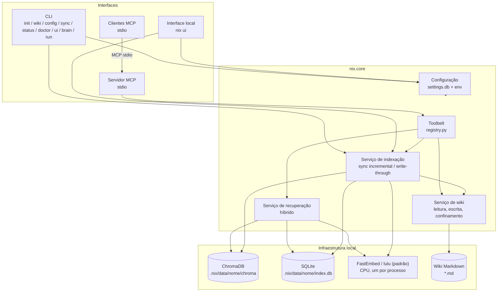
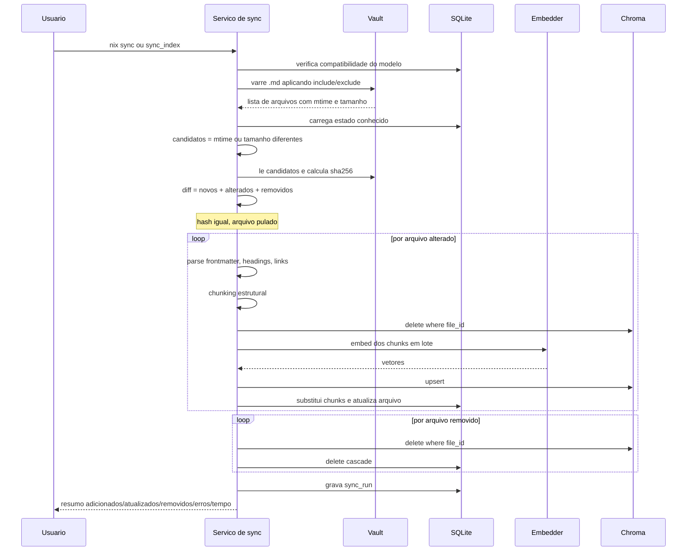
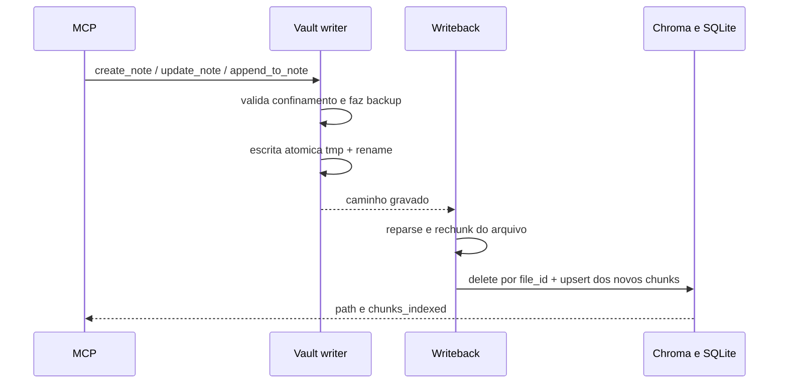
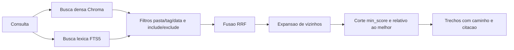

# TDD — Nix

Especificações técnicas do Nix, servidor MCP que expõe wikis em Markdown a agentes de desenvolvimento.

Contexto de negócio e requisitos: [PRD.md](./PRD.md).

---

## 1. Princípios de design

1. **Núcleo independente de interface.** Toda a lógica vive em `nix.core`. CLI, MCP e a interface local são adaptadores finos que chamam os mesmos serviços. Nenhuma regra de negócio é duplicada.
2. **Local por padrão.** Embeddings e banco vetorial rodam na máquina do usuário, sem custo e sem enviar o vault para terceiros. O Nix não faz chamadas remotas.
3. **Indexação sob consentimento.** Não existe watcher de arquivos. O vault só é varrido quando o usuário pede (`nix sync` / ferramenta `sync_index`) ou quando as próprias ferramentas escrevem (write-through).
4. **A wiki é a fonte da verdade.** O índice é um artefato derivado e descartável: apagar a pasta daquela wiki em `index.data_dir` (padrão `.nix/data/<nome>`) e rodar `nix sync --full --wiki NOME` reconstrói tudo.
5. **Ferramentas antes de prompts.** A capacidade exposta ao cliente é um conjunto pequeno e bem tipado de ferramentas, definido uma vez em `core/tools/registry.py`.
6. **Falhar de forma explícita.** Erros de configuração, defasagem de índice e ausência de resultados são comunicados, nunca mascarados.

## 2. Stack

| Camada | Tecnologia | Justificativa |
| --- | --- | --- |
| Linguagem | Python 3.11+ (CI e tipos em 3.14) | Ecossistema de IA e requisito do projeto |
| Embeddings | FastEmbed ONNX na CPU. Padrão `lulu` (MiniLM multilíngue, ~220 MB); `spitz` é o `BAAI/bge-m3` (~2,3 GB) | Local, gratuito, multilíngue, sem GPU, sem PyTorch |
| Banco vetorial | ChromaDB 1.5.x em modo persistente | Local, gratuito, embutido; faixa pinada pelo grafo de import (OTEL/gRPC) |
| Busca léxica | SQLite FTS5 | Já disponível na stdlib; complementa a busca vetorial em termos exatos |
| Estado do índice | SQLite | Controle de arquivos, hashes e chunks; transacional |
| CLI de bootstrap | Typer + Rich | Comandos tipados, ajuda automática, saída formatada e progresso |
| Servidor MCP | SDK oficial `mcp` (FastMCP, **somente stdio**) | O cliente inicia o processo; stdout é do protocolo |
| Interface local | Starlette + Uvicorn (já no SDK `mcp`) + Jinja2, HTMX e CSS próprio (`web/static/nix.css`) vendidos no pacote | Operação e consulta no navegador, sem Node, sem build e sem CDN |
| Configuração | SQLite (`settings.db`) + Pydantic | Histórico e desfazer no mesmo arquivo, validação forte, override por variável de ambiente |
| Parsing de Markdown | `python-frontmatter` + splitter consciente de cabeçalhos | Preserva metadados e estrutura das notas |
| Qualidade | ruff, mypy | Padrão do ecossistema |

**Por que embeddings locais e não `text-embedding-3`:** o requisito é custo zero na indexação. Um vault grande gera dezenas de milhares de chunks e cada reindexação completa teria custo. Os dois modelos rodam na CPU e são multilíngues. A `lulu` é o padrão porque o sync cabe num computador com pouca folga. O `spitz` (`bge-m3`) fica para quem tem CPU, memória e disco de sobra e quer mais qualidade na busca.

**Por que Chroma e não FAISS/LanceDB:** Chroma persiste sozinho, guarda metadados junto do vetor e permite deletar por `file_id` na sincronização incremental. Filtros de pasta/tag/data são aplicados na camada de recuperação (prefixo de pasta, tags, `mtime`), não como `where` de igualdade no Chroma — subpastas continuam visíveis. FAISS exigiria gerenciar o mapeamento id↔metadado manualmente.

## 3. Visão de componentes



Um processo MCP (ou `nix ui`) atende de 1 a 100 wikis. `RuntimeHost` guarda um `Runtime` por nome, criado na primeira resolução e fechado quando a wiki sai do `settings.db`. `resolve(nome | None)` abre uma wiki (nome omitido usa o padrão). `resolve_many(nome | lista | "*")` abre várias; nome desconhecido lista as cadastradas e diz qual é o padrão. O modelo de embedding é um só (`index.embedding_model`): o `Embedder` é do processo, com `threading.RLock` no carregamento e no `embed`, para duas wikis não rodarem inferência ao mesmo tempo.

### 3.1 Pastas por wiki

`index.data_dir` e `safety.backup_dir` continuam globais. O que é de um vault fica numa subpasta com o nome cadastrado:

| Artefato | Caminho |
| --- | --- |
| Índice (SQLite + Chroma) | `{index.data_dir}/<nome>/` (padrão `.nix/data/<nome>/`) |
| Backups | `{safety.backup_dir}/<nome>/` (padrão `.nix/backups/<nome>/`) |
| Trava de sync e write-through | `{app_root}/.nix/sync-<nome>.lock` |

A trava é por vault: um pode sincronizar enquanto outro é lido. Renomear o vault não move índice nem backups; a CLI avisa para rodar `nix sync --full --wiki NOME` se a busca ficar vazia. Remover o vault do cadastro também deixa essas pastas no disco.

O vault migrado do esquema 1 é a exceção: o índice (`index.db` e o chroma) continua na raiz de `{index.data_dir}` e os backups na raiz de `{safety.backup_dir}`, para a busca e os backups não ficarem vazios. Vaults cadastrados depois usam a subpasta do nome.

## 4. Estrutura do projeto

```
nix/
├── install.bat / install.sh / install.ps1  # baixa o binário, confere SHA-256, registra PATH e pede para executar `nix`
├── uninstall.bat / uninstall.sh / uninstall.ps1  # remove PATH/NIX_HOME, o binário, .nix, settings.db e o cache onefile/hook
├── bin/nix / bin/nix.cmd   # shims só do checkout de desenvolvimento (acham o .venv)
├── bin/env.sh / bin/env.cmd / bin/env.ps1  # ativação manual do PATH no checkout
├── __main__.py             # `python -m nix` a partir do projeto pai (pasta nix/)
├── scripts/bootstrap.py    # venv + pip + PATH (desenvolvimento); não roda nix init
├── scripts/build_frozen.py # Nuitka onefile, Python 3.12, na plataforma local
├── scripts/smoke_frozen.py # gate de --version, doctor --json e nix-hook
├── scripts/check_bdd.py    # cobertura dos cenários de docs/bdd/ pelos testes
├── scripts/release_registry.py # MCPB por plataforma e a ficha server.json
├── scripts/register_path.py # NIX_HOME e PATH do checkout de desenvolvimento
├── scripts/uninstall.py    # desfaz PATH, artefatos do checkout e o cache onefile/hook
├── nix.jpeg                # foto da Nix (mascote no README)
├── settings.db            # config local (não versionado; criado por `nix init`)
├── .nix/                   # estado local: data (SQLite+Chroma), backups, logs, brain.db
├── pyproject.toml          # metadados do pacote e entry point do comando `nix`
├── requirements.txt        # dependências de runtime
├── requirements-dev.txt    # dependências de desenvolvimento
├── README.md
├── docs/
│   ├── PRD.md
│   ├── TDD.md
│   ├── BDD.md              # índice dos casos de uso do BDD
│   ├── bdd/                # critérios de aceite em Gherkin, um arquivo por caso de uso (um teste por cenário)
│   └── DESIGN.md           # estilo visual da CLI e da interface local
├── site/                   # guia publicado no GitHub Pages (index.html, PDF, ícone)
├── .github/workflows/
│   ├── release.yml         # tag vX.Y.Z: checagens, binários, MCP Registry
│   └── pages.yml           # push na main que altera site/ publica o guia
├── tests/                  # pytest; conftest.py isola NIX_HOME e troca o embedder
├── AGENTS.md / CLAUDE.md   # instruções de agente (CLAUDE.md importa o AGENTS.md)
├── HARNESS.md              # regras específicas deste repositório
├── skills-lock.json        # origem das skills de desenvolvimento
├── .claude/skills/ / .agents/skills/  # skills de desenvolvimento
├── .cursor/
│   └── mcp.json            # command = binário em NIX_HOME (caminho absoluto no Unix)
└── src/
    ├── nix_launch.py           # relança o venv, desfaz sombreamento da pasta nix/; `nix-hook brain` segue direto para core/brain/hook_entry
    ├── nix_frozen.py           # entrada do binário completo; não relança o .venv
    ├── nix_hook_frozen.py      # entrada do binário leve `nix-hook`
    └── nix/
        ├── __init__.py             # versão: pyproject.toml no checkout; metadata no binário
        ├── __main__.py             # python -m nix (pacote instalado)
        ├── config/
        │   ├── schema.py           # modelos Pydantic da configuração e textos de ajuda
        │   ├── embedding_models.py # catálogo técnico dos embeddings (validação + FastEmbed)
        │   ├── embedding_present.py # textos de apresentação dos modelos (CLI e interface)
        │   ├── store.py            # settings.db: valores, histórico, versão do esquema
        │   ├── editor.py           # gravação validada (CLI e interface)
        │   ├── loader.py           # precedência env > banco > padrão; wikis vêm da tabela
        │   ├── executables.py      # no binário, o hook acha o `nix` irmão ou em NIX_HOME/bin
        │   └── paths.py            # app_root; no binário, NIX_HOME ou a pasta de dados da plataforma
        ├── core/
        │   ├── wiki/
        │   │   ├── reader.py       # varredura, filtros, leitura segura
        │   │   ├── writer.py       # escrita atômica, backup, YAML, confinamento
        │   │   ├── markdown.py     # frontmatter, cabeçalhos, wikilinks, tags, links
        │   │   ├── frontmatter_edit.py  # edição linha a linha do YAML
        │   │   ├── paths.py        # normalização e validação de caminhos
        │   │   └── longterm.py     # remember → notas na wiki
        │   ├── index/
        │   │   ├── store.py        # SQLite: arquivos, chunks, metadados
        │   │   ├── chunker.py      # divisão consciente da estrutura
        │   │   ├── embedder.py     # FastEmbed em lote; RLock na carga e no embed
        │   │   ├── native_compat.py # mmh3 nativo ou stub (só import FastEmbed)
        │   │   ├── tokenize.py     # tiktoken, com aproximação se a DLL falhar
        │   │   ├── vectorstore.py  # adaptador Chroma
        │   │   ├── sync.py         # diff e sincronização incremental
        │   │   ├── lock.py         # trava entre processos (.nix/sync-<nome>.lock)
        │   │   ├── writeback.py    # reindexação write-through
        │   │   ├── attachments.py  # texto de PDFs referenciados
        │   │   ├── graph.py        # grafo de wikilinks (cache)
        │   │   └── staleness.py    # aviso de defasagem (só Markdown)
        │   ├── retrieval/
        │   │   ├── vector.py       # busca densa
        │   │   ├── lexical.py      # busca FTS5
        │   │   ├── fusion.py       # Reciprocal Rank Fusion
        │   │   └── service.py      # fachada de recuperação
        │   ├── insights/           # órfãs, duplicatas, links, resumo
        │   ├── brain/              # Mega Brain (só stdlib nos módulos que o hook importa)
        │   │   ├── hook_entry.py   # `nix-hook brain`: stdin → evento → brain.db; briefing no stdout do início
        │   │   ├── agents.py       # agentes, rótulos e formato do contexto; captura parcial sem arquivo inventado
        │   │   ├── events.py       # normaliza o JSON; id determinístico; raiz Git do projeto
        │   │   ├── sanitize.py     # segredos e corte UTF-8
        │   │   ├── limits.py       # brain.* lido do settings.db sem Pydantic, para o hook
        │   │   ├── store.py        # brain.db: projects, sessions, observations, handoffs, messages, tokens, profile
        │   │   ├── capture.py      # consentimento: ligado, hook e .nix.toml
        │   │   ├── pages.py        # página da sessão por regras
        │   │   ├── worker.py       # no session-end, o nix-hook abre o binário completo (`brain work`)
        │   │   ├── briefing.py     # perfil, handoff, resumo, mensagens, sessão interrompida
        │   │   ├── handoff.py      # um aberto por projeto; accept reivindica uma vez
        │   │   ├── profile.py      # listas EN/PT, min_projects, lápide
        │   │   ├── inbox.py        # fila; pop atômico
        │   │   ├── tokens.py       # id de resposta uma vez; sem uso, desconhecido
        │   │   ├── query.py        # brain_query sobre a busca híbrida da wiki
        │   │   ├── project.py      # .nix.toml: project, capture, profile
        │   │   ├── run.py          # nix run: hook, MCP e histórico temporário
        │   │   ├── history/        # leitores v1: Claude Code e Codex
        │   │   └── paths.py        # página, perfil e URI somente leitura do SQLite
        │   ├── runtime.py          # RuntimeHost: resolve / resolve_many, Embedder compartilhado
        │   ├── admin/              # init, doctor, WikiService, agent_hooks, empty_dirs
        │   └── tools/
        │       ├── args.py         # WikiArgs (um nome) e MultiWikiArgs (nome, lista ou "*")
        │       ├── registry.py     # definição canônica das ferramentas
        │       ├── search.py
        │       ├── notes.py
        │       ├── maintenance.py
        │       └── brain.py        # ferramentas brain_*; host_only; só no MCP com brain.enabled
        ├── cli/
        │   ├── app.py              # entrypoint Typer (terminal sem args → interface; senão, stdio)
        │   ├── ascii-art.txt
        │   ├── commands/
        │   │   ├── setup.py        # init, doctor
        │   │   ├── wiki_cmds.py    # nix wiki list/add/rename/remove/default/path/set
        │   │   ├── config_cmds.py  # config list/get/set/unset/history/undo
        │   │   ├── ui_cmd.py       # nix ui
        │   │   ├── brain_cmds.py   # nix brain enable/status/hooks/handoff/profile/work
        │   │   ├── run_cmds.py     # nix run <agente>
        │   │   └── index_cmds.py   # sync, status (status via call_tool)
        │   ├── agents.py           # agentes pedidos ou confirmados, e a raiz do projeto
        │   ├── embedding_copy.py   # tabela do nix init; textos em config/embedding_present.py
        │   └── render.py           # tema e o resultado de cada comando; erros em stderr
        ├── mcp/
        │   ├── server.py           # FastMCP/MCPServer stdio; recarrega a config entre chamadas
        │   ├── traffic.py          # log de interações MCP (arquivo e .nix/traffic.db)
        │   ├── registry.py         # MCPB da release e a ficha server.json
        │   └── resources.py        # nix://note/… no padrão; nix://wiki/{name}/note/…
        ├── web/                    # nix ui: Starlette, templates Jinja2, HTMX e nix.css vendidos
        │   └── routes/             # ops, wiki, integration, maintenance, brain
        └── observability/
            ├── logging.py
            └── stdio.py            # isola stdout de bibliotecas
```

Quem usa o Nix instala um binário único (Nuitka, arquivo só, sem Python na máquina). O instalador (`install.ps1` / `install.sh`, e `install.bat` que delega ao PowerShell) baixa o artefato da release, confere o SHA-256, grava `NIX_HOME` e pede para executar `nix`. Não roda `nix init`. A tela Wikis cadastra a pasta; a marca que libera o MCP e o `nix ui` só o `nix init` grava. O desinstalador em shell puro desfaz o PATH e apaga o binário, `.nix/` e `settings.db`.

O checkout de desenvolvimento continua com `venv` e `pip`: `python scripts/bootstrap.py` cria `.venv`, instala `requirements.txt` e o pacote em modo editável (`pip install -e .`). `scripts/uninstall.py` desfaz esse checkout. O `pyproject.toml` se limita aos metadados do pacote e à declaração do *entry point* `nix`. No checkout, com o pacote em `src/nix`, `nix.__version__` lê `[project].version` desse arquivo, para uma instalação editável não mostrar metadata velho. Fora do checkout, vale o metadata do pacote instalado. O binário é compilado por `scripts/build_frozen.py` com Python 3.12.

## 5. Modelo de dados

### 5.1 SQLite (`{index.data_dir}/<nome>/index.db`, padrão `.nix/data/<nome>/index.db`)

Guarda o estado do índice: o que já foi processado, com qual conteúdo e com qual modelo. É a base do diff incremental.

```sql
CREATE TABLE files (
    id            TEXT PRIMARY KEY,       -- uuid estável por caminho relativo
    rel_path      TEXT NOT NULL UNIQUE,   -- 'Projetos/Nix.md'
    title         TEXT,
    content_hash  TEXT NOT NULL,          -- sha256 do conteúdo
    mtime         REAL NOT NULL,
    size_bytes    INTEGER NOT NULL,
    frontmatter   TEXT,                   -- JSON
    tags          TEXT,                   -- JSON array
    links         TEXT,                   -- JSON array de wikilinks
    chunk_count   INTEGER NOT NULL DEFAULT 0,
    indexed_at    TEXT NOT NULL,
    status        TEXT NOT NULL           -- indexed | error | ignored
);

CREATE TABLE chunks (
    id            TEXT PRIMARY KEY,       -- '{file_id}:{ordinal}'
    file_id       TEXT NOT NULL REFERENCES files(id) ON DELETE CASCADE,
    ordinal       INTEGER NOT NULL,
    heading_path  TEXT,                   -- 'Arquitetura > Indexação'
    content       TEXT NOT NULL,
    title         TEXT NOT NULL DEFAULT '',
    token_count   INTEGER NOT NULL,
    start_line    INTEGER,
    end_line      INTEGER,
    embed_hash    TEXT                    -- hash do texto vetorizado; nulo até o sync do arquivo
);

-- Busca léxica sobre os mesmos chunks
CREATE VIRTUAL TABLE chunks_fts USING fts5(
    content, heading_path, title,
    content='chunks', content_rowid='rowid', tokenize='unicode61'
);

CREATE TABLE index_meta (
    key   TEXT PRIMARY KEY,               -- embedding_model, dim, vault_path,
    value TEXT NOT NULL                   -- schema_version, last_sync_at
);

CREATE TABLE sync_runs (
    id           INTEGER PRIMARY KEY AUTOINCREMENT,
    started_at   TEXT NOT NULL,
    finished_at  TEXT,
    trigger      TEXT NOT NULL,           -- manual | writeback
    added        INTEGER DEFAULT 0,
    updated      INTEGER DEFAULT 0,
    removed      INTEGER DEFAULT 0,
    failed       INTEGER DEFAULT 0,
    error_log    TEXT
);
```

`embed_hash` guarda o hash do texto vetorizado de cada chunk (RF-150). Um índice criado antes dessa coluna a recebe por `ALTER TABLE`, sem trocar o `schema_version`.

`index_meta.embedding_model` é comparado a cada execução: se o usuário trocar o modelo na configuração, o índice é considerado incompatível e o Nix exige `nix sync --full` em vez de misturar vetores de espaços diferentes.

### 5.2 Coleção Chroma

Uma coleção `nix_notes` por vault, em `{index.data_dir}/<nome>/chroma`, um vetor por chunk, `id` idêntico ao `chunks.id`. Metadados armazenados junto:

| Campo | Uso |
| --- | --- |
| `file_id` | Deleção em massa na reindexação de um arquivo |
| `rel_path`, `title` | Citação e abertura da nota |
| `heading_path` | Contexto do trecho na resposta |
| `tags` | Filtro por tag (após a busca; armazenado como string concatenada no Chroma) |
| `folder` | Prefixo da pasta (inclui subpastas), filtrado após a busca — sem `where` de igualdade no Chroma |
| `mtime` | Filtro por recência e desempate |
| `ordinal` | Reconstrução da ordem e expansão de vizinhos |

### 5.3 Mega Brain (`{app_root}/.nix/brain.db`)

SQLite em WAL, fora da wiki e fora do índice. Cada operação abre e fecha a conexão. As escritas usam `BEGIN IMMEDIATE` para o `accept` do handoff e o `pop` da mensagem serem atômicos. O `sessions.db` antigo não é lido nem migrado.

Tabelas: `projects`, `sessions` (chave `projeto|agente:id`), `observations` e `observations_fts`, `handoffs` (índice único parcial com no máximo um `offered` por projeto), `messages` (destinatário e entrega única), `token_calls` (`response_id` único), `profile_entries` e `profile_evidence` (lápide em `status`), `page_feedback`, `hook_installs` (escopo global ou projeto).

A configuração `brain.*` fica no `settings.db`: `enabled` (padrão falso), `wiki`, `briefing_max_bytes` (padrão 3000) e `idle_end_after_hours` (padrão 0). `profile.min_projects` padrão 2.

### 5.4 Migração de nomes

O `settings.db` sobe para o esquema 3: a seção antiga `vault` é copiada e a tabela `vaults` é renomeada para `wikis`, sem alterar pastas de índice nem de backup. O meta `vault_path` do índice ainda é lido; sincronizações novas gravam `wiki_path`.

## 6. Pipeline de indexação

### 6.1 Detecção de mudanças



O filtro em duas etapas — `mtime`/tamanho primeiro, hash depois — evita ler todo o vault a cada sincronização e evita reindexar arquivos que só tiveram o timestamp alterado (comum em sincronização por Dropbox/Git).

Cada arquivo é uma transação independente: uma interrupção deixa o índice consistente, e a execução seguinte reprocessa apenas o que faltou (RNF-07).

### 6.2 Chunking

Notas Markdown têm estrutura semântica em cabeçalhos, e cortá-las por número fixo de caracteres destrói essa estrutura. A estratégia:

1. Extrair frontmatter YAML (vira metadado JSON-serializável — datas ISO — não texto indexado).
2. Dividir por cabeçalhos Markdown (`#` até `####`), mantendo o caminho hierárquico (`Projeto Nix > Arquitetura > Indexação`).
3. Seções maiores que o limite são subdivididas recursivamente por parágrafo/sentença, com sobreposição configurável.
4. Seções muito pequenas (ex.: um cabeçalho com duas linhas) são agrupadas com a seção seguinte, evitando chunks sem sinal.
5. Blocos de código nunca são partidos ao meio.
6. Cada chunk é prefixado, apenas para o embedding, com `título da nota > caminho de cabeçalhos`, o que melhora a recuperação de trechos curtos.

Valores padrão: 800 tokens por chunk, 120 de sobreposição, mínimo de 80 tokens — todos configuráveis.

### 6.3 Vetorização write-through

Quando a escrita parte das ferramentas MCP, a atualização do índice faz parte da operação (RN-02):



O reprocessamento é de um único arquivo. Se a indexação falhar após a escrita, o arquivo no vault permanece (fonte da verdade), o registro vai para `status = 'error'` e a resposta informa que a nota foi salva mas não indexada — o usuário deve rodar `nix sync` ou `sync_index`. Frontmatter YAML é gravado com valores escapados; datas (`created: auto` → ISO) serializam como string, para o JSON do SQLite não quebrar em objetos `date`.

### 6.4 Aviso de defasagem

`index_status` compara a **contagem de notas Markdown** visíveis no vault com a de arquivos `.md` indexados, e o `mtime` e o tamanho de cada nota com a linha dela no índice. Uma nota gravada pelo write-through já está alinhada e não gera aviso, mesmo sendo mais nova que `last_sync_at`. PDFs anexos no índice não entram nessa conta (evita aviso falso de defasagem). Se houver divergência, devolve `stale=true`. A mensagem `stale_reason` só é preenchida quando `index.warn_when_stale=true`. Não há indexação implícita (RN-01).

### 6.5 Reaproveitamento de vetores (RF-150)

O id do chunk é `arquivo:ordinal` e se desloca com qualquer inserção no meio da nota, então o reaproveitamento casa **só pelo hash** do `embed_text` (texto com o prefixo `título > cabeçalhos`). Em `Indexer._commit_index`: lê os hashes e os vetores antigos do arquivo (`VectorStore.embeddings_for_file`, `get(where={"file_id": ...}, include=["embeddings"])`), calcula o embedding só dos chunks sem hash correspondente, apaga os chunks do arquivo e faz o `upsert` com os vetores reaproveitados e os novos. O `SyncReport` informa `chunks_reused` e `chunks_embedded`. `nix sync --full` zera os hashes junto com o índice.

## 7. Recuperação



- **Densa** resolve similaridade conceitual ("como configurar o retry" ↔ "política de nova tentativa").
- **Léxica** resolve termos exatos que embeddings costumam diluir: nomes próprios, siglas, códigos de erro, nomes de arquivo. `retrieval.expand_query=true` junta tokens com OR (mais recall); `false` usa AND (mais precisão).
- **Filtro de pasta** vale para a pasta e subpastas (`Inbox` inclui `Inbox/sub/nota.md`), aplicado em cada ramo **antes** do RRF.
- **RRF** funde os dois rankings: `score(d) = Σ 1 / (k + rank_i(d))`, com `k = 60`.
- **Expansão de vizinhos** recupera os chunks `ordinal ± 1` dos melhores resultados.
- **Corte de score** descarta trechos abaixo de `max(min_score, melhor × 0.65)`.

`search_notes` sempre passa por `search_many`, com uma wiki ou com várias. A consulta é vetorizada uma vez. Cada wiki roda a híbrida com `candidate_pool` e os filtros, sem corte final. Os trechos são juntados, ordenados pelo score, e então `min_score` e `top_k` valem para o conjunto. Falha numa wiki vai para `wiki_errors`, com a ação corretiva, e as outras seguem. Cada trecho traz o nome da wiki.

Cada trecho devolvido por `search_notes` inclui `wiki`, `rel_path`, `title`, `heading_path`, `content` e `citation` no formato `[[Título]]` / `[[Título#Seção]]` (RN-04). A síntese em linguagem natural é responsabilidade do cliente MCP. A busca comum não esconde as páginas do Mega Brain: quem quiser só elas usa `brain_query`.

## 8. Ferramentas

Definidas uma única vez em `core/tools/registry.py` (`SPECS`: 20 ferramentas de wiki; com `brain.enabled`, mais 18 `brain_*` — 38 no total) e registradas no servidor MCP. A CLI de bootstrap chama `call_tool` para `index_status`; `nix sync` usa o mesmo `Indexer.sync` da ferramenta (com barra de progresso), uma wiki por vez.

`WikiArgs` é um nome, ou o padrão se o campo vier vazio. `MultiWikiArgs` aceita um nome, uma lista ou `"*"`. A comparação ignora maiúsculas. Escrita, leitura de uma nota, links e insights recusam lista e `"*"`. Busca, `list_notes`, `list_all_tags`, `index_status` e `sync_index` aceitam várias. `list_wikis` não recebe wiki: devolve todas. A resposta traz `wiki` (um nome ou a lista das consultadas).

| Ferramenta | Assinatura | Efeito no índice |
| --- | --- | --- |
| `search_notes` | `(query, top_k=5, folder?, tags?, date_from?, date_to?, wiki?) -> {results, wiki_errors}` | — ; junção em `search_many` |
| `read_note` | `(rel_path, wiki?) -> NoteContent` | — |
| `get_note_outline` | `(rel_path, wiki?) -> NoteOutline` (título, chaves, linhas, headings) | — |
| `read_note_lines` | `(rel_path, start_line?, end_line?, heading?, wiki?) -> NoteLines` | — |
| `list_notes` | `(folder?, tag?, limit=50, wiki?) -> {notes}` | — ; o limite vale **por wiki** e as listas são juntadas |
| `list_all_tags` | `(folder?, limit=200, wiki?) -> {tags}` | — ; soma as contagens de cada wiki e só então aplica o limite; o detalhe por wiki permanece |
| `get_linked_notes` | `(rel_path, direction=both, wiki?) -> list[NoteRef]` | — |
| `create_note` | `(rel_path, content, frontmatter?, wiki?) -> WriteResult` | write-through; pasta padrão `default_new_note_folder` (`Inbox`) se o caminho não tiver `/` |
| `append_to_note` | `(rel_path, content, section?, wiki?) -> WriteResult` | write-through |
| `update_note` | `(rel_path, content, mode=replace\|patch\|prepend, confirm, wiki?) -> WriteResult` | write-through; `prepend` não exige `confirm` |
| `update_frontmatter` | `(rel_path, set?, remove?, wiki?) -> WriteResult` | write-through; só a chave alterada é reemitida |
| `manage_tags` | `(rel_path, add?, remove?, wiki?) -> WriteResult` | write-through; tags inline do corpo ficam |
| `move_note` | `(src, dest, update_links=true, overwrite, confirm, wiki?) -> WriteResult` | `after_move`: remove o id antigo, indexa o caminho novo e as notas reescritas |
| `move_file` | `(src, dest, update_links=true, overwrite, confirm, wiki?) -> WriteResult` | igual a `move_note` para o id; PDF só entra no índice com `index.index_attachments` |
| `delete_note` | `(rel_path, confirm, wiki?) -> WriteResult` | remove do índice |
| `sync_index` | `(full=False, dry_run=False, wiki?) -> {reports}` | uma wiki por vez; um relatório por wiki |
| `index_status` | `(wiki?) -> {wikis}` | — ; um status por wiki |
| `wiki_insights` | `(kind, limit=20, wiki?) -> insights` | — |
| `remember` | `(content, title?, wiki?) -> WriteResult` | write-through em `longterm_folder` da wiki |
| `list_wikis` | `() -> {wikis}` | — ; nome, caminho, padrão e se o índice está desatualizado |
| `brain_query` | `(query, project?, scope?, path_prefix?, tag?, kind?)` | — ; só com `brain.enabled`; busca na wiki do Mega Brain e nas observações |
| `brain_read_page` / `brain_recent_pages` / `brain_write_page` / `brain_patch_page` / `brain_delete_page` | caminho relativo na wiki do Mega Brain | write-through nas que gravam; `brain_delete_page` exige `confirm=true` |
| `brain_briefing` / `brain_status` / `brain_feedback` / `brain_read_session_observations` | projeto atual | — ; o briefing não consome o handoff |
| `brain_handoff_create` / `brain_handoff_list` / `brain_handoff_accept` / `brain_handoff_cancel` | um aberto por projeto | `accept` reivindica uma única vez |
| `brain_message_send` / `brain_message_list` / `brain_message_pop` / `brain_message_cancel` | fila do projeto | `pop` entrega uma única vez |

Ferramentas destrutivas (`update_note` em modo `replace`, `delete_note`) exigem `confirm=true` e levam `destructiveHint` para o cliente pedir aprovação ao usuário (RF-34). `move_note` e `move_file` não levam `destructiveHint`; sobrescrever o destino ainda exige `overwrite=true` e `confirm=true`. `read_note_lines` devolve no máximo 400 linhas (`truncated`, `next_start_line`). As linhas de `search_notes`, do outline e de `read_note_lines` são do arquivo bruto, com o frontmatter incluído.

`wiki_insights` (órfãs, duplicatas, sugestão de wikilinks, resumo) usa o índice SQLite. A sugestão de links não relê a wiki. `brain_write_page`, `brain_patch_page` e `brain_delete_page` também levam `destructiveHint`.

Todas as ferramentas de nota recebem `rel_path` relativo à wiki. `core/wiki/paths.py` resolve, normaliza, rejeita `..`, caminhos absolutos e links simbólicos que escapem da wiki (RN-03).

## 9. Interfaces

### 9.1 Instalador e CLI de bootstrap

O instalador na raiz do repositório não entra no núcleo: só baixa o binário e registra o PATH. Não exige Python.

```
install.ps1 / install.sh          # release estável (ou NIX_VERSION) → SHA-256 → {NIX_HOME}/bin/nix e nix-hook
install.bat                       # delega a install.ps1
uninstall.ps1 / uninstall.sh      # PATH, binário, settings.db, .nix e cache onefile/hook (não o vault)
uninstall.bat                     # delega a uninstall.ps1
scripts/bootstrap.py              # só desenvolvimento: .venv → pip → register_path; não roda nix init
scripts/build_frozen.py           # Nuitka --mode=onefile com Python 3.12; também gera o nix-hook
scripts/smoke_frozen.py           # --version só com a versão; doctor --json com cada Import em ok; nix-hook em 300 ms
```

O binário publicado cobre Windows amd64, Linux amd64 (glibc do Ubuntu 22.04), Linux arm64 e macOS arm64. Windows arm64 e macOS Intel não têm artefato: o instalador recusa com a arquitetura esperada. O modelo ONNX continua fora do arquivo; o primeiro `nix sync` baixa do Hugging Face.

O GitHub também anexa o zip e o tar do código da tag, gerados por `git archive`. O `.gitattributes` usa `export-ignore` para tirar skills de desenvolvimento, documentação, testes, exemplos, configuração de editor e de CI e os scripts que só compilam ou conferem. Permanecem o pacote, o manifesto, as dependências de execução, os wrappers e os instaladores. A compilação da release usa o checkout inteiro, não esse zip.

O mesmo job monta um `.mcpb` por plataforma (`scripts/release_registry.py`) e a ficha `server.json` (`io.github.paulocesaaars/nix`). Os dois sobem na release. Em seguida o `mcp-publisher` publica a ficha no MCP Registry, com login OIDC do GitHub. O guia em `site/` sai por outro workflow: push na `main` que altera `site/` publica `https://paulocesaaars.github.io/nix/`.

`NIX_HOME` já definido (variável de usuário no Windows, ou o bloco dos rc no Unix) é a pasta da instalação, e o binário novo substitui `{NIX_HOME}/bin`. Sem `NIX_HOME`, a pasta é `%LOCALAPPDATA%\nix`, `~/Library/Application Support/nix` ou `${XDG_DATA_HOME:-~/.local/share}/nix`. A instalação não cadastra a wiki. Ao terminar, pede para executar `nix` e, se o comando não funcionar, fechar e abrir o terminal. O instalador roda `nix --version` uma vez para aquecer o cache do modo onefile (`{CACHE_DIR}/nix/onefile-{VERSION}`) e `nix-hook hook` para aquecer o cache `hook-{VERSION}`. O comando `nix` vale num **novo** terminal. Se já existir outro `nix` no PATH (gerenciador NixOS), o instalador avisa.

O desinstalador pede confirmação (dispensada com `--yes`). Remove `NIX_HOME` e a entrada do PATH só se apontarem para esta instalação. Apaga também o cache de extração (`onefile-*` e `hook-*` em `{CACHE_DIR}/nix` e na pasta da instalação) e, se a pasta da instalação ficar vazia, a pasta. No Linux e no macOS esse cache não é a pasta da instalação; só entram diretórios com esses prefixos, para não apagar outros arquivos em `~/.cache/nix`. `--keep-data` preserva `settings.db` e `.nix/` e ainda apaga o cache de extração. O vault não é alterado. O modelo no cache do Hugging Face fica: pode ser compartilhado com outros programas.

No binário, `app_root()` ignora o checkout (o `__file__` da extração não é o repositório) e não usa o CWD: vale `$NIX_HOME` ou a pasta de dados da plataforma. `settings.db` e `.nix/` ficam nessa pasta. Copiar só o executável para outro diretório continua usando a mesma pasta de dados.

```
nix                           # terminal (stdin TTY): abre a interface, mesmo sem nix init
                              # sem terminal: servidor MCP stdio, que exige nix init
nix init [--name NOME] [--wiki PATH] [--embedding-model NOME] [--force]
                              # pergunta (ou recebe) a primeira wiki; nome padrão Default
                              # sem --force, configuração existente só atualiza o caminho do padrão
                              # --name com wikis já cadastradas pede `nix wiki add`
                              # grava a marca initialized, que o MCP e o nix ui exigem
nix wiki list|add|rename|remove|default|path|set
                              # cadastro; rename não move índice nem backups
                              # path troca a pasta; set grava include/exclude e as pastas daquela wiki
nix config list|get|set|unset|history|undo
nix sync [--full] [--dry-run] [--json] [--wiki NOME]... [--all]
nix status [--json] [--wiki NOME]... [--all]
                              # status via call_tool("index_status")
nix doctor [--json]           # relatório de todas as wikis; --json serializa o DoctorReport
nix ui [--no-browser] [--port N]
                              # interface local; exige nix init
nix brain enable|status|hooks|handoff|profile
nix run AGENTE [--no-autowire] [--project PASTA]
```

`--wiki` em `sync` e `status` pode repetir. `--all` percorre todas, em sequência. Os dois juntos são recusados. Sem nenhum dos dois, vale a wiki padrão. `--json` em `sync` e `status` emite o relatório em formato estruturado, com um item por wiki. `nix doctor --json` serializa o relatório de diagnóstico (ambiente, configuração e checagens, entre elas uma por wiki). Erros de domínio (`NixError`) saem no stderr, sem traceback. `wiki`, `config`, `sync`, `status` e `ui` falham com ação corretiva se o `nix init` ainda não rodou. `nix` no terminal abre a interface mesmo assim. `nix wiki remove` recusa o padrão até `nix wiki default` apontar outro, e recusa a última wiki. `nix wiki rename` preserva a grafia nova e avisa para `nix sync --full --wiki NOME` se a busca ficar vazia. `nix wiki path` troca a pasta. `nix wiki set` grava `include`, `exclude`, `follow_symlinks`, `default_new_note_folder`, `default_frontmatter` ou `longterm_folder`; listas e objetos entram como JSON. Nome no formato `AAAAMMDDTHHMMSS` é recusado. Renomear, remover, `path` e `set` são recusados enquanto a sincronização daquela wiki não termina.

No terminal, `nix` sem subcomando chama `open_interface` (navegador, porta livre) e não exige wiki cadastrada. Sem TTY, o mesmo comando sobe o servidor stdio. O cliente MCP não vê a interface.

### 9.2 Servidor MCP

Transporte **somente stdio**. O cliente inicia o processo (o binário em `{NIX_HOME}/bin`; no checkout de desenvolvimento, `python -P -m nix` no venv). A subida chama `require_initialized`: sem `nix init`, o processo termina com a ação corretiva. Expõe as ferramentas da seção 8 e, adicionalmente, notas como recursos MCP. `nix://note/{+rel_path}` lê na wiki padrão (barras no caminho; `|` também é aceito). `nix://wiki/{name}/note/{+rel_path}` lê na wiki nomeada. Nome desconhecido devolve o erro que lista as wikis e o padrão. O cliente anexa a nota ao contexto sem consumir uma chamada de ferramenta.

O servidor tenta `FastMCP` e, se o SDK recente expuser só `MCPServer`, usa essa classe — ambas precisam de `.tool()`, `.run()` e `transport="stdio"`. Falha de instância ou de transporte vira `ConfigError` com ação corretiva (`pip install 'mcp>=1.9.0'`). `NixError` na subida vai para stderr e encerra com código 1, sem vazar traceback no stdout.

Registro no Cursor (`.cursor/mcp.json`). `command` aponta para o binário **na pasta da instalação** (`NIX_HOME`), não para `nix` no PATH: a IDE aberta pelo Dock/menu não herda o PATH do shell (`spawn nix ENOENT`). A linha `comando nix:` do `nix doctor` é esse caminho. No checkout de desenvolvimento, os shims `bin/nix` e `bin/nix.cmd` chamam o Python do `.venv` com `-P -m nix`.

**Windows**

```json
{
  "mcpServers": {
    "nix": {
      "command": "${env:NIX_HOME}/bin/nix.exe"
    }
  }
}
```

No Windows a variável de usuário `NIX_HOME` está visível na IDE. O caminho absoluto (`C:/Users/voce/AppData/Local/nix/bin/nix.exe`) também vale.

**macOS / Linux**

```json
{
  "mcpServers": {
    "nix": {
      "command": "/Users/voce/Library/Application Support/nix/bin/nix"
    }
  }
}
```

Troque pelo caminho da linha `comando nix:` do `nix doctor`. `"command": "nix"` falha na IDE. `${env:NIX_HOME}` em geral não expande: o processo da IDE não lê os rcs do shell. No Linux a pasta padrão é `~/.local/share/nix/bin/nix`.

O servidor não escreve em stdout — o canal é do protocolo. Interações (`initialize`, `tools/list`, `tools/call`, `resources/read`) vão só para o arquivo de log. Argumentos das ferramentas (consultas, caminhos) só entram no log se `logging.log_prompts=true`. `ping` e notificações ficam em nível debug. Trocar `logging.file` ou o nível passa a valer quando o processo recarrega a configuração.

Antes de cada ferramenta, o processo compara um carimbo que junta a data mais recente de `settings` e `wikis`, o maior `id` de `settings_history` e a quantidade de wikis. Assim uma remoção também recarrega. Se mudou, recarrega a configuração e mantém `index.embedding_model` e a pasta-base do índice deste processo (a pasta é comparada já resolvida). O runtime de um vault que saiu só é fechado quando a sincronização dele já soltou a trava; enquanto a trava está presa, o processo não abre um segundo cliente de índice no mesmo diretório. Enquanto modelo ou pasta-base divergirem, a resposta da ferramenta inclui `config_warning`. A leitura de resource registra o mesmo aviso no log e devolve só o texto da nota. Troca de modelo continua exigindo `nix sync --full`.

### 9.3 Interface local

`nix ui` sobe Starlette em `127.0.0.1`, numa porta livre (ou `--port`), imprime a URL e abre o navegador (`--no-browser` só imprime). O processo termina com Ctrl+C ou com o botão Encerrar. Se houver sincronização, o botão pede para esperar e o Ctrl+C só fecha o índice depois que a thread termina. Sem `nix init`, o comando não sobe.

O token da URL vira cookie `HttpOnly` (`SameSite=Strict`). Pedidos seguintes exigem esse cookie. POST exige o mesmo token no formulário ou no header `X-CSRF-Token`. `Host` e `Origin` têm de ser o endereço local. Arquivos estáticos (HTMX, extensão SSE, `nix.css` e `nix.js`) estão no pacote; não há CDN nem fonte remota (a interface usa as fontes do sistema).

Telas: status do índice, sincronização (prévia, progresso por SSE, opção de todas as wikis e confirmação extra para `--full`), diagnóstico, Mega Brain, tela Wikis, formulário de configuração (campo de ambiente fica travado) e histórico com desfazer. O formulário grava os campos globais alterados numa transação; se o conjunto fica inválido, nada daquele envio entra no banco. O cadastro das wikis não passa por esse formulário. Nome, caminho, padrão, pasta e ajustes (`include`, `exclude`, `follow_symlinks`, pastas) ficam no `WikiService`, o mesmo de `nix wiki`. Renomear, remover, trocar a pasta ou gravar um ajuste é recusado enquanto a sincronização daquele vault não termina. A sincronização roda numa thread, um vault por vez, e segura a trava `.nix/sync-<nome>.lock` daquele vault, a mesma do `nix sync` e do write-through. Há um job por processo. O progresso cita o vault atual.

Os controles de sincronização (prévia, incremental, reindexação e "todos os vaults") ficam num fieldset desligado enquanto o job existe. O primeiro clique desliga o fieldset inteiro antes da resposta. O POST de início devolve esse fieldset desligado fora da área do progresso, porque a resposta volta antes de o modelo terminar de carregar. O fim do job devolve o mesmo fieldset habilitado. Recarregar `/sync` no meio lê o job ainda em andamento e renderiza o fieldset desligado. Um segundo início, ou uma prévia com job ativo, recebe 409 no aviso da página e não substitui o progresso. A prévia não varre o vault nesse caso. Sem job, a prévia percorre um vault por vez e solta a trava daquele vault antes do próximo.

O seletor de wiki fica no topo da barra lateral ("Wiki ativo", com o caminho da wiki escolhida logo abaixo), antes da navegação; no celular vira uma linha compacta, com o caminho truncado. É um formulário GET com `?wiki=`; os outros parâmetros da URL são preservados. Nome vazio ou ausente cai no padrão. A Busca tem a própria escolha: uma wiki, várias ou todas (`wiki=*`), e cada trecho exibe a wiki de origem. O menu tem os grupos Operação, Wiki, Mega Brain, Integração e Manutenção.

Telas de consulta (só leitura): busca, notas (lista, contorno, linhas e links), tags e insights chamam `call_tool` do registro, o mesmo caminho do MCP. `RuntimeGate` tem uma trava por vault, para ler um enquanto outro sincroniza. Se a trava daquele vault estiver ocupada, a tela pede para esperar em vez de bloquear. O diagnóstico da interface percorre os vaults deste processo; `nix doctor` no terminal abre o seu.

Conectar cliente mostra também o estado dos hooks do Mega Brain no projeto da pasta onde o `nix ui` roda (ou de outro projeto que já tenha sessões, com `?project=`). A página não grava o arquivo: a instalação continua no `nix brain hooks install`. Monta o trecho de Cursor, VS Code, Claude Code e Codex em `core/admin/client_config.py`, com o executável de `nix_command()` (o mesmo do `nix doctor`). A lista de ferramentas vem de `SPECS`; `destructive` e `read_only` definem o selo. As páginas saem com `Referrer-Policy: same-origin`, para o POST de um formulário comum levar a origem deste `nix ui`.

Tráfego MCP: o middleware de `mcp/traffic.py` grava cada `tools/call` em `{app_root}/.nix/traffic.db` (`core/admin/traffic.py`), tabela `mcp_calls` com quando, cliente (do `initialize`), ferramenta, argumentos resumidos (só com `logging.log_prompts`), situação, duração e erro. Cada gravação abre e fecha a conexão em WAL (o esquema é criado uma vez por processo), porque servidor e interface são processos diferentes; a interface lê em modo somente leitura e não cria o arquivo. A tabela guarda as 5.000 chamadas mais recentes. O texto de erro só é gravado com `logging.log_prompts`; sem ele o banco guarda apenas que houve erro. Se a gravação falhar, o servidor registra um aviso e tenta de novo na chamada seguinte; depois de 3 falhas seguidas, para de gravar naquele processo. A chamada nunca é afetada.

Backups (`core/admin/backups.py`): lista `{safety.backup_dir}/<nome>/{AAAAMMDDTHHMMSS}/{rel_path}`, compara com a nota atual por `difflib` e serve o arquivo para download. Carimbo e caminho são validados e não saem da pasta de backups daquela wiki. A comparação é pulada acima de 512 KB (o `difflib` é quadrático); o download segue disponível. Restaurar exige confirmação, vale só para `.md` e passa por `WikiWriter.update_note(mode="replace")` (ou `create_note`, se a nota foi removida) e `Writeback.after_write`, então o estado atual ganha backup e o índice é atualizado.

### 9.4 Hooks do Mega Brain

`nix brain hooks install` grava o arquivo de cada agente, no projeto ou na conta. No projeto: Cursor `.cursor/hooks.json`, VS Code `.github/hooks/nix.json`, Claude Code `.claude/settings.local.json`, Codex `.codex/hooks.json`. Na conta, o Claude usa `.claude/settings.json`; o VS Code não tem arquivo global e a captura fica parcial, sem JSON inventado. A tabela `AgentSpec` de `core/admin/agent_hooks.py` reúne o formato. Há prévia, confirmação e backup em `safety.backup_dir/hooks/` antes de alterar um arquivo que já existe. A marca da Nix é o comando `brain --event E --agent A`. O subcomando antigo `hook` ainda é reconhecido na remoção. O VS Code tem campos por sistema (`bash` com `[ -x ] && ... || true`, `powershell` com `Test-Path`) para terminar em silêncio onde o binário não existe.

No binário, o agente chama `nix-hook brain`, não o `nix` completo: o Nuitka 4.3 recalcula o CRC do payload onefile em toda partida, e o arquivo completo passa de 1 s. O cache do hook é `hook-<versão>`. No checkout, `nix_launch` manda `brain` para `core/brain/hook_entry.py` antes do Typer. Esse módulo evita o import da CLI. Os limites `brain.*` saem de uma leitura direta do `settings.db` (`limits.py`). O fluxo é stdin → `normalize` (com sanitização) → `capture.record`, só com o Mega Brain ligado e com hook daquele agente. No `session-start`, o briefing vai para o stdout no formato do agente. A ordem do texto está no PRD (RF-164). O código de saída é sempre 0. O erro vai para `.nix/logs/brain-hook.log`.

No `session-end`, `worker.schedule` abre um processo destacado. No binário, `cli_to_launch` procura o `nix` completo ao lado do `nix-hook` ou em `{NIX_HOME}/bin`. Se não achar, registra a falha no mesmo log e não grava a página. No checkout, o comando é `python -m nix brain work`. Uma trava `brain-work.lock` impede duas gravações ao mesmo tempo. A página passa pelo `WikiWriter`, com backup e write-through. `brain.idle_end_after_hours` vale 0 e não encerra sessão sozinho. O comando oculto `nix hook` (e `nix-hook hook`, usado só para aquecer o cache na instalação) termina com código 0 e não grava nada.

### 9.5 Skills

O Nix não instala skill de produto. Não há `src/nix/skills` nem o comando `nix skills`. As pastas `.claude/skills/` e `.agents/skills/` deste repositório são só do desenvolvimento.

## 10. Configuração

Banco `{app_root}/settings.db`, fora de `index.data_dir`. No binário, `app_root` é `$NIX_HOME` ou a pasta de dados da plataforma. No checkout, `app_root` é a pasta do repositório, senão `$NIX_HOME`, senão o CWD. Caminhos relativos (`data_dir`, `backup_dir`, `logging.file`) resolvem contra `app_root`, não contra o CWD. Precedência dos campos globais: **variável de ambiente > settings.db > padrão** (RF-03). Variáveis no formato `NIX_SECAO__CAMPO` (ex.: `NIX_INDEX__EMBEDDING_MODEL`). `NIX_VAULT__*` e `NIX_WIKI__*` são ignorados: o cadastro vive na tabela `wikis`. `nix init` grava a primeira wiki, o modelo e a marca `initialized`. Estado do índice (SQLite, Chroma, backups, logs) continua em `{app_root}/.nix/`, com subpasta por wiki, exceto a wiki migrada do esquema 1, que permanece na raiz (seção 3.1).

```sql
CREATE TABLE meta (
    key   TEXT PRIMARY KEY,   -- schema_version, initialized
    value TEXT NOT NULL
);
CREATE TABLE settings (
    section    TEXT NOT NULL,  -- index, retrieval, safety, logging, brain, profile
    key        TEXT NOT NULL,
    value_json TEXT NOT NULL,
    updated_at TEXT NOT NULL,
    PRIMARY KEY (section, key)
);
CREATE TABLE settings_history (
    id             INTEGER PRIMARY KEY AUTOINCREMENT,
    section        TEXT NOT NULL,  -- seção global, ou "wikis"
    key            TEXT NOT NULL,  -- campo, ou o nome da wiki
    old_value_json TEXT,          -- nulo se a chave não existia
    new_value_json TEXT,          -- nulo se a chave foi removida
    source         TEXT NOT NULL, -- init | cli | ui | migration
    changed_at     TEXT NOT NULL
);
CREATE TABLE wikis (
    name          TEXT PRIMARY KEY COLLATE NOCASE,
    path          TEXT NOT NULL,
    is_default    INTEGER NOT NULL CHECK (is_default IN (0, 1)),
    settings_json TEXT NOT NULL,  -- include, exclude, pastas padrão daquela wiki
    created_at    TEXT NOT NULL,
    updated_at    TEXT NOT NULL
);
CREATE UNIQUE INDEX wikis_one_default
    ON wikis(is_default) WHERE is_default = 1;
```

`schema_version` é `3`. Na abertura, a versão 1 vira 2 (a seção `vault` vira a linha `Default`) e a 2 vira 3: a tabela `vaults` é renomeada para `wikis` e o histórico com `section = vaults` passa a `wikis`, sem mover índice nem backups. A wiki do esquema 1 fica com `legacy_layout` e continua na raiz de `index.data_dir` e `safety.backup_dir` (seção 3.1). As versões 1 e 2 não são erro. Qualquer outra pede `nix init --force`. `--force` apaga ajustes, wikis e histórico e recria o esquema; as notas não são alteradas. Lista vazia de wikis é o estado anterior ao init e é válida no `load_config`. A marca `initialized` só o `nix init` grava. Com wikis cadastradas, a validação exige de 1 a 100, exatamente um padrão, nomes únicos sem diferenciar maiúsculas (`^[A-Za-z0-9][A-Za-z0-9_-]{0,31}$`, grafia original preservada) e caminhos que não se sobrepõem. Um nome no formato `AAAAMMDDTHHMMSS` é recusado: é o carimbo das pastas de backup. `include`, `exclude`, `follow_symlinks`, `default_new_note_folder`, `default_frontmatter` e `longterm_folder` nascem em `settings_json` com o padrão do schema e mudam com `nix wiki set` (listas e objetos em JSON). O padrão de `exclude` é `.trash/**`, `Templates/**` e `Privado/**`. `nix wiki path` troca a pasta. O editor genérico não grava o cadastro e aponta para esses comandos.

As seções `brain` (`enabled` falso, `wiki` vazio, `briefing_max_bytes` 3000, `idle_end_after_hours` 0) e `profile` (`min_projects` 2) aceitam `NIX_BRAIN__*` e `NIX_PROFILE__*`. Só `brain.enabled` exige reinício do cliente MCP para as ferramentas `brain_*` aparecerem.

O texto de ajuda de cada campo global está no schema Pydantic. `index.embedding_model` grava o id do Hugging Face: `lulu` é `sentence-transformers/paraphrase-multilingual-MiniLM-L12-v2` e `spitz` é `BAAI/bge-m3`. A raça também é aceita na gravação. O número da tabela do `nix init` não é um id e só vale nesse comando. `index.auto_sync_external_changes` não pode ser ligado (RN-01). Trocar modelo, pasta-base do índice ou tamanho de chunk avisa que é preciso `nix sync --full` e, no caso do modelo e de `data_dir`, reiniciar o processo. Trocar `index.index_attachments` avisa que é preciso `nix sync`. O carimbo do recarregamento a quente junta a data mais recente, o maior id do histórico e a quantidade de wikis, para uma remoção também ser percebida.

Toda gravação valida o conjunto com Pydantic antes de persistir. Erros trazem o campo e a ação corretiva (RF-04, RNF-09). No Windows, o caminho da wiki é gravado com `/`. O histórico permite desfazer uma alteração global (`nix config undo` ou o botão da interface), gravando o desfazer como uma mudança nova. Mudanças de wiki entram no mesmo histórico com `section="wikis"`.

## 11. Segurança

| Vetor | Controle |
| --- | --- |
| Escrita fora do vault | Resolução canônica de caminho e verificação de prefixo; rejeição de `..`, caminhos absolutos e symlinks que escapem |
| Perda de conteúdo | Escrita atômica (arquivo temporário + rename), backup versionado antes de sobrescrever, confirmação obrigatória |
| Exposição de notas privadas | Filtros `exclude` aplicados na indexação **e** na leitura, para que uma nota excluída não seja acessível nem por `read_note` |
| Corrupção do protocolo MCP | stdout reservado ao stdio; logs só em arquivo; `silence_progress_env` na inicialização; FastEmbed com `capture_stdout=True` por padrão (a CLI de `sync` desliga só para mostrar o download); `NixError` só no stderr |
| Injeção via conteúdo de nota | Trechos recuperados são dados estruturados (caminho + conteúdo); ferramentas destrutivas sempre exigem confirmação humana |
| Corrupção do índice | Transação por arquivo, verificação de compatibilidade de modelo, reconstrução completa sempre disponível; trava de sync por vault |
| Interface local | Escuta só em 127.0.0.1; token de uso único vira cookie HttpOnly; checagem de Host e Origin; CSRF nos POST; `Referrer-Policy: same-origin` para o navegador enviar a origem nos formulários comuns |

## 12. Desempenho

| Operação | Alvo | Estratégia |
| --- | --- | --- |
| Sync incremental sem mudanças (5.000 notas) | < 2s | Comparação por `mtime`/tamanho antes de ler conteúdo |
| Sync inicial (1.000 notas) | ~5 min sem GPU | Embedding em lote, ONNX em CPU, paralelismo de parsing |
| Reindexação write-through de 1 nota | < 100ms | Escopo de um único arquivo |
| Busca híbrida | < 500ms | HNSW do Chroma + FTS5, ambos locais |

O carregamento do modelo de embedding é preguiçoso. Modelos que o FastEmbed 0.8 não lista (ex.: `BAAI/bge-m3`) são registrados a partir do catálogo em `config/embedding_models.py`. O primeiro uso baixa o ONNX do Hugging Face por HTTP, com o hf-xet desligado: esse backend aborta o arquivo quando um pedaço chega fora de ordem. `HF_HUB_DISABLE_XET` é definida antes de importar o FastEmbed e não substitui um valor que já esteja no ambiente, então `HF_HUB_DISABLE_XET=0` religa o xet. O aviso de symlink do cache no Windows fica desligado do mesmo jeito. `nix status` não carrega o modelo. `prepare_native_imports` roda na subida do `Runtime`, antes do Chroma e do FastEmbed: no Windows o Controle de Aplicativo pode bloquear `mmh3` e `cygrpc` (comum no Python 3.14 do checkout; o binário publicado é 3.12 e, se ainda bloquear, o `doctor` aponta o cache `onefile-<versão>`). O Nix desbloqueia o import (o Chroma local usa `RustBindingsAPI` e não precisa de gRPC). A dependência é `chromadb>=1.5,<1.6` porque o stub OTEL cobre o grafo de import da série 1.5.

## 13. Decisões arquiteturais

| # | Decisão | Alternativas consideradas | Motivo |
| --- | --- | --- | --- |
| AD-01 | Embeddings locais (FastEmbed; padrão `lulu`, `spitz` opcional) | `text-embedding-3-small` da OpenAI | Custo zero na indexação e reindexação; multilíngue e sem GPU |
| AD-02 | ChromaDB persistente | FAISS, LanceDB, Qdrant local, pgvector | Persistência e deleção por `file_id` nativas; filtros de pasta/tag na camada de recuperação |
| AD-03 | SQLite como estado do índice | Arquivo JSON de manifesto | Transacional, consultável, e traz FTS5 de graça para a busca léxica |
| AD-04 | Sem LLM no Nix | LangGraph + OpenAI no processo | O raciocínio fica no cliente MCP; o Nix só entrega ferramentas |
| AD-05 | Sincronização manual, sem watcher | `watchdog` observando o vault | Requisito de controle do usuário; evita processo em background e reindexações em rajada durante edição |
| AD-06 | Registry único de ferramentas | Implementações separadas para CLI e MCP | Elimina divergência de comportamento e duplicação de regras de segurança |
| AD-07 | Busca híbrida desde a fundação | Somente densa | Notas pessoais são cheias de nomes próprios e siglas que o embedding dilui |
| AD-08 | Artefatos de índice na pasta do aplicativo (`.nix/`), fora do vault | `.nix/` dentro do vault | Mantém os artefatos separados das notas; o estado acompanha o aplicativo |
| AD-09 | MCP somente stdio | HTTP como transporte do MCP | O cliente inicia o processo; não há porta no protocolo. A interface local é outro processo, só enquanto `nix ui` está aberto |
| AD-10 | Binários Nuitka onefile (`nix` e o `nix-hook` leve; checkout de desenvolvimento segue com `scripts/bootstrap.py`) | PyInstaller onefile, venv com o Python do sistema | Sem runtime na máquina do usuário. A partida seguinte reusa o cache `{CACHE_DIR}/nix/onefile-{VERSION}`. O `nix-hook` existe porque o Nuitka 4.3 recalcula o CRC do payload inteiro a cada partida, e o binário completo passa de 1 s. O modo arquivo único do PyInstaller descompacta a cada processo e atrasa o stdio do MCP |
| AD-11 | Configuração em `settings.db` na pasta da instalação | TOML, JSON, índice SQLite | A config não se perde ao apagar `.nix/data`. Histórico e desfazer ficam no mesmo arquivo. O ambiente continua ganhando do valor gravado |
| AD-12 | Interface com Starlette, HTMX e CSS próprio vendidos no pacote | Streamlit, NiceGUI, app com Node; Pico.css; Tailwind | Sem build e sem chamada remota. Starlette e Uvicorn já vêm com o SDK MCP. O Pico (sem classes) não cobria menu lateral, selos, abas, diff e cartões sem sobrescrever quase tudo; Tailwind exigiria build ou CDN |
| AD-13 | Várias wikis no mesmo processo, com um Embedder compartilhado | Uma instalação (e um processo MCP) por wiki | Uma conexão MCP atende todas. O modelo de embedding é global e pesado para carregar mais de uma vez. Índice, backup e trava ficam isolados pelo nome. O limite é 100 |
| AD-14 | `nix-hook brain` com ponto de entrada mínimo | Chamar a CLI do Typer no evento | A CLI estoura o orçamento de 300 ms do hook. O binário completo recalcula o CRC do payload a cada partida |
| AD-15 | Reaproveitar vetor por hash do texto do chunk | Casar por id (`arquivo:ordinal`); reindexar o arquivo inteiro | O id se desloca a cada inserção no meio da nota |
| AD-16 | Páginas do Mega Brain na wiki escolhida, pelo writer comum | Banco vetorial separado; migrar o `sessions.db` | Reaproveita backup e write-through. O banco antigo não é lido |
| AD-17 | No `session-end`, o `nix-hook` abre o binário completo (`brain work`) | Gravar a página dentro do hook | O hook não carrega o índice. Se o `nix` não estiver em `NIX_HOME/bin`, a falha fica em `brain-hook.log` |
| AD-18 | Download do ONNX por HTTP, com hf-xet desligado | hf-xet, padrão do Hugging Face Hub | O xet aborta o arquivo quando um pedaço chega fora de ordem, comum em rede com proxy ou antivírus. `HF_HUB_DISABLE_XET=0` no ambiente religa |

## 14. Evolução prevista

- Conjunto de avaliação `eval/` (harness e perguntas; ainda não está no repositório).

## 15. Testes e critérios de aceite

Os critérios de aceite das funcionalidades ficam em Gherkin na pasta [`bdd/`](./bdd), um arquivo por
caso de uso; o [BDD.md](./BDD.md) é o índice. Cada cenário
tem um ID (`@HU-03.2`) e o teste que o cobre leva o mesmo ID:

```python
@pytest.mark.bdd("HU-03.2")
def test_sync_without_changes(vault: Path, fake_embedder: type[FakeEmbedder]) -> None: ...
```

- **Rodar:** `pytest` (dependência de desenvolvimento). `-m "not slow"` pula o
  que usa o modelo de embedding real. No editor, o launch `Nix: testes` roda
  essa mesma seleção.
- **Fixtures** (`tests/conftest.py`): `nix_home` é automática e aponta
  `app_root` para uma pasta temporária, então nenhum teste toca no
  `settings.db` nem no `.nix/` do checkout; `vault` cria um vault temporário;
  `fake_embedder` troca o FastEmbed por vetores determinísticos, sem baixar o
  ONNX. `second_vault` é outra pasta, vazia e sem cadastro; `second_registered`
  cadastra essa pasta com o nome `Outro`, que não é o padrão.
  `tests/web/conftest.py` sobe a interface com sessão e CSRF (`client`);
  `embed_hold` segura o embedding enquanto o teste de sincronização em andamento
  precisa que os controles continuem desligados.
- **Cobertura:** `python scripts/check_bdd.py` lista os cenários sem teste, falha se um
  teste apontar para um ID inexistente e confere se o índice e a pasta `docs/bdd/`
  batem. `--strict` também falha
  com cenário sem teste. Cenários `@manual` viram checklist da release.
